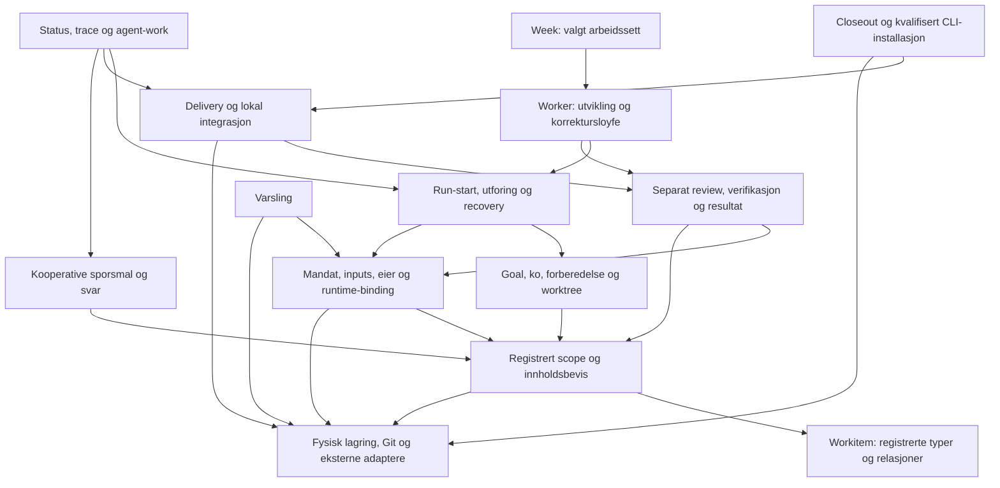
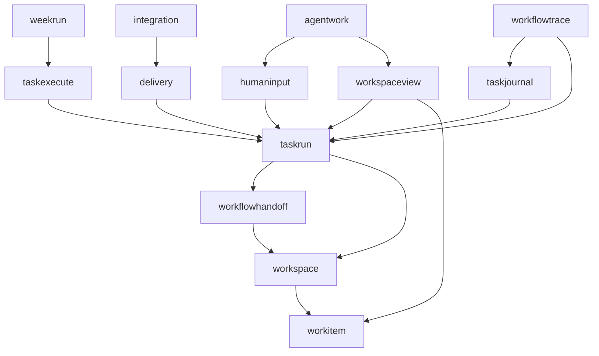

# AG01 — Dagens agentic support i Ply

> Historisk dokument etter fjerningen av den kompilerte prosesskjeden.
> Execute-, worker/week-, delivery- og integrasjonsorkestreringen som omtales
> her er ikke en kjørbar oppskrift i dagens kilde. Fjernede kildefiler er
> bevart som historiske stier. Se [gjeldende direkte operasjoner](../README.md#human-owned-process).

Ply knytter registrert arbeid til et frosset mandat, en bestemt utfører og etterprøvbare resultater. `workspace` eier registreringer, innhold og Git-livsløp; `taskrun` samler mye av utføring, transport, recovery og kandidatlevering. Lesemodulene bygger egne visninger av disse faktaene. Det viktigste ved senere oppdeling er å bevare hvem som eier en overgang, hvilke bevis den bruker, og når de må leses på nytt.

Dette er et navigasjonskart og beslutningsgrunnlag, ikke en refaktoreringsbestilling. Kodekapabilitet, aktivert workspace-format, faktisk prosessobservasjon, teknisk aksept, menneskelig vurdering og levert resultat er forskjellige fakta.

## Kildegrunnlag og metode

- Analysert 25.10.2026: commit `fef6ddeedb7a5bab32956ee396c4fe896143ac2e`, tree `7e0ba3135f5ea15efd98689ed82910ed91589b88`.
- Task: `ply-agentic-support-map-20261025`; presentasjonskode **AG01**. Dokumentet er skrevet etter dette kildeøyeblikket; produksjonskoden er uendret.
- Metode: statisk lesing av CLI-registrering, representative funksjonskropper, Go-importer, skjemaer, eksisterende tester og tidligere analyser. Lenker er relative til repoet; symbolnavn peker på Go-funksjoner, typer og metoder, ikke klasser.
- Tester nevnt nedenfor er kildehenvisninger, ikke påstander om kjøring i AG01. Ingen produkttester, fullsuite, coverage, providerforsøk eller browser-/prosesseksperimenter inngår.
- Dokumentkontrollen sjekker lokale lenker, representative deklarasjoner, viste importkanter, en begrenset Mermaid-flowchart-grammatikk og whitespace. Den er ingen full Mermaid-renderer eller semantisk bevisføring. Native review og acceptance dokumenteres separat for den eksakte kandidaten.

Les først funksjonsgrafen og dekningsmatrisen. Bruk deretter flytene for caller-retning og tabellen over delt tilstand før et avgrenset endringsforslag vurderes.

## Funksjonsgraf: basis, sammensetning og løv

I dette kartet betyr **A → B at A trenger B** funksjonelt. Det er verken tidsrekkefølge eller en påstand om direkte Go-kall. Basis har ingen utgående avhengighet innen det valgte utsnittet; produktløv har ingen inngående kant fra en annen vist funksjon. Utsnittet samler recovery med utføring og resultatpublisering med verifikasjon. Det er ikke en full graf over hvert CLI-verb.

`MODEL` og `IO` er basis i dette funksjonsutsnittet. De er svært ulike: rene relasjoner kontra effekter. `PREP`, `OWNER`, `EXEC`, `VERIFY` og `DELIVERY` er sammensatte funksjoner. `WEEK`, `CLOSE`, `STATUS` og `NOTICE` er produktløv **i denne grafen**; varsling brukes også av integrasjonsløpet utenfor de viste kantene. Et annet utsnitt kan derfor klassifisere dem annerledes. CLI-kommandoer er innganger; eksempelvis brukes execute også av week og er ikke automatisk et løv.

## Dekning: funksjonsfamilier og kodeinnganger

**Levert** betyr at implementasjon finnes i analysert kilde. Det betyr ikke at en funksjon er aktivert, valgt i et bestemt mandat eller prøvd mot levende tjenester. «Historisk» nedenfor betyr bevart alternativ/kompatibilitet, ikke nødvendigvis fjernet funksjonalitet.

| Familie | Levert ansvar og viktig avgrensning | Pakke, representative symboler og kilde |
| --- | --- | --- |
| Registrert scope | Workspace, Project, Repo, Epic og Task binder fysisk plassering og eierskap. Ren modell er skilt fra lagring. | `workspace` / `workitem`: `WorkItemStore`, `WorkItemStoreSession` i [work_item_store.go](../internal/workspace/work_item_store.go); typer og relasjoner beskrevet i [WI01](workitem-core.md). |
| Problem, Spec og Goal | Immutable revisjoner, assessment og selection; Goal materialiseres til en bestemt execution-Spec. Første Goal kan registreres gjennom ett koordinert løp. | `RecordTaskProblem`, `RecordTaskSpec`, `AssessTaskSpec`, `SelectTaskSolution` i [task_content.go](../internal/workspace/task_content.go); `RegisterFirstGoal` i [task_first_goal.go](../internal/workspace/task_first_goal.go). |
| Kø, base og forberedelse | Valgt mål, køhistorikk, Epic-base og worktree-intent kontrolleres før start. Gjentatt identisk forespørsel kan finne opprinnelig forberedelse. | `PreviewTaskGoalExecution`, `buildGoalExecutionPreviewInTarget` i task_goal_execution.go (`internal/workspace/task_goal_execution.go`, historisk kilde); `buildPreparePlan` i [task_preparation.go](../internal/workspace/task_preparation.go); [epic_base.go](../internal/workspace/epic_base.go). |
| Worktree-alternativer | Native opprettelse, eksplisitt adopsjon av eksisterende Task-kilde og kontrollert closeout har egne bindingsregler. | [task_adoption.go](../internal/workspace/task_adoption.go), [epic_create.go](../internal/workspace/epic_create.go), `ApplyTaskCloseoutWithOwnershipGuard` i [task_closeout.go](../internal/workspace/task_closeout.go). |
| Mandat og inputs | Handoff binder scope, autoriserte effekter, inputdigester, mottaker og svaridentitet. Kandidatbevis knyttes tilbake til dette grunnlaget. | `workflowhandoff`: `Create` i [service.go](../internal/workflowhandoff/service.go), [task_spec.go](../internal/workflowhandoff/task_spec.go), `QualifyDeliveryCandidate` i [delivery_candidate.go](../internal/workflowhandoff/delivery_candidate.go). |
| Start og provider | Execute velger runtime fra Goal og oppretter eller gjenfinner native Run. Interaktiv Claude/Codex bruker Herdr; headless har eget løp. | `taskexecute.Execute` i service.go (`internal/taskexecute/service.go`, historisk kilde), `PreviewRuntime` i runtime.go (`internal/taskexecute/runtime.go`, historisk kilde), `taskrun.WorkflowStart` i [herdr_service.go](../internal/taskrun/herdr_service.go), [herdr_transport.go](../internal/taskrun/herdr_transport.go). |
| Mottak og runtime | `check-in` følger frosset `mandate_receipt_v1`; mottak er ikke generell tillatelse. Historisk `begin` beholder sin opprinnelige kontrakt. | `WorkflowDeliveryReceipt`, `WorkflowDeliveryBegin` i [delivery_begin.go](../internal/taskrun/delivery_begin.go); [delivery_runtime_observation.go](../internal/taskrun/delivery_runtime_observation.go). |
| Fortsettelse, stopp og recovery | Samme Run/eier bevares der kontrakten tillater det; oppstartsrecovery, eier-resume, avslag, kvote/kapasitet og retirement har forskjellige beviskrav. Ukjent tidligere effekt gir ikke ny start. | `ResumeOwner` i owner_resume.go (`internal/taskexecute/owner_resume.go`, historisk kilde); [delivery_start_recovery.go](../internal/taskrun/delivery_start_recovery.go), [delivery_stop.go](../internal/taskrun/delivery_stop.go), [delivery_continuation.go](../internal/taskrun/delivery_continuation.go), backup_retirement.go (`internal/taskrun/backup_retirement.go`, historisk kilde). |
| Spørsmål og svar | Kooperativ `workflow input` lagrer spørsmål, ett svar og agentrapportert mottak/bruk. Separat schema-2 bound-answer kan fortsette en eksplisitt valgt week-eid Codex-økt. | `humaninput.AskDraft`, `Apply`, `Acknowledge`, `Continue` i [service.go](../internal/humaninput/service.go); [human-input-kontrakt](../schemas/workflow-human-input-v1/README.md), bound-answer (`docs/workflow-bound-answer.md`, historisk kilde), product_answer_worker_unix.go (`internal/taskrun/product_answer_worker_unix.go`, historisk kilde). |
| Review og verifikasjon | Interaktivt review er en separat reviewer på samme Run og eksakte kandidat. Acceptance kjøres, stdout/stderr bevares og kandidatstabilitet kontrolleres før kvalifisering. | `WorkflowDeliveryRequestReview`, `WorkflowDeliveryReviewReturn` i delivery_review_round.go (`internal/taskrun/delivery_review_round.go`, historisk kilde); `workflowDeliveryVerify` i [delivery_callback.go](../internal/taskrun/delivery_callback.go), [delivery_automatic_verification.go](../internal/taskrun/delivery_automatic_verification.go). |
| Resultat og aksept | TaskResult og kravbevis kommer fra bundet verifikasjon/review. Automatisk policy og faktisk menneskelig QA er egne akser; et reelt veto kan ikke erstattes av teknisk pass. | [delivery_candidate.go](../internal/workflowhandoff/delivery_candidate.go), [delivery_acceptance.go](../internal/workspace/delivery_acceptance.go), [delivery_human_qa.go](../internal/workspace/delivery_human_qa.go). |
| Delivery | Separat registrerbar Delivery støtter PR, lokal Epic og eksplisitt lokal branch. PR-levering avslutter ved observert PR; merge er et annet løp. | `delivery.Service.Register`, `Check`, `Execute` i service.go (`internal/delivery/service.go`, historisk kilde) og execute.go (`internal/delivery/execute.go`, historisk kilde); `PRAdapter` i github.go (`internal/delivery/github.go`, historisk kilde). |
| Integrasjon og installasjon | Lokal retur binder resultat/target og lukker kø/base. Menneskestyrt integrasjon, PR-merge og eksplisitt installasjonsprofil ligger også i egen modul. Kvalifisert Ply CLI-installasjon er en koordinatoreffekt. | `WorkflowDeliveryIntegrate` i delivery_completion.go (`internal/taskrun/delivery_completion.go`, historisk kilde), `CompleteLocalDelivery` i [delivery_authority.go](../internal/taskrun/delivery_authority.go); integration/execute.go (`internal/integration/execute.go`, historisk kilde), install.go (`internal/integration/install.go`, historisk kilde), delivery_cli_install.go (`internal/taskrun/delivery_cli_install.go`, historisk kilde). |
| Closeout og beholdt kilde | Levert, frigitt eierskap og slettet kilde er forskjellige tilstander. Writer-bevis og delt Git kan utsette cleanup; beholdt kilde har egne receipts. | delivery_automatic_closeout.go (`internal/taskrun/delivery_automatic_closeout.go`, historisk kilde), [delivery_task_writers.go](../internal/taskrun/delivery_task_writers.go), [task_closeout_retention.go](../internal/workspace/task_closeout_retention.go), [delivery-retained-effects.md](delivery-retained-effects.md). |
| Status og read models | Registrert snapshot, fremdrift, attention, inventory, worktrees og endringer projiseres uten å oppfinne liveness eller effektfullmakt. | `workspaceview.LoadSnapshot` i [snapshot.go](../internal/workspaceview/snapshot.go), `ReadWorkflowStatusWithInventory` / `BuildWorkflowStatus` i [workflow_status.go](../internal/workspaceview/workflow_status.go); `taskrun.ReadInventory` i [read_inventory.go](../internal/taskrun/read_inventory.go). |
| Journal og trace | Task-prosessjournal og historiske Run-kjeder sammenstilles med provenance og kildekontroll. Uavhengige kjeder får ikke en oppdiktet global kronologi. | `taskjournal.Service.Append` i [store.go](../internal/taskjournal/store.go); `workflowtrace.Read`, `builder.finish` i [read.go](../internal/workflowtrace/read.go) og [project.go](../internal/workflowtrace/project.go). |
| Agentmetadata og oppfølging | `agent-work` kobler native arbeid, Herdr-identitet og metadata. Followup er avgrenset statusprompt med veto ved spørsmål, stopp og ukjent dekning. | `agentwork.System`, `readNative` i [native.go](../internal/agentwork/native.go), [followup.go](../internal/agentwork/followup.go), [metadata.go](../internal/agentwork/metadata.go). |
| Varsling | Autorisert rute, kilde-/eventidentitet og transportutfall bevares separat. HTTP-ukjent er ikke levert eller rett til blind gjentakelse. | `workflownotification`: [service.go](../internal/workflownotification/service.go), `sendHTTP`, `classify` i [transport.go](../internal/workflownotification/transport.go); [workflow-notification.md](workflow-notification.md). |
| Worker, week og kontroll | Headless Codex utvikler, committer, pretester, reviewer, verifiserer og integrerer under avgrensede forsøk. Week velger fra et frosset arbeidssett. Pause/stop venter på sikker forsøksgrense; unknown blokkerer. | `workerStep` i worker_pipeline.go (`internal/taskrun/worker_pipeline.go`, historisk kilde), `ServeWorker` i worker_unix.go (`internal/taskrun/worker_unix.go`, historisk kilde); `weekrun.Manager.Tick` i manager.go (`internal/weekrun/manager.go`, historisk kilde), `NativeAdapter` i native.go (`internal/weekrun/native.go`, historisk kilde), control_contract.go (`internal/taskrun/control_contract.go`, historisk kilde). |
| Parallell native utføring | Eksplisitte interaktive Goals kan få separate aktive forberedelser etter format-8-aktivering. Retur serialiseres; flyttet parent krever kontrollert reconcile og ny kvalifisering. | `admissionAllowed` i [task_participation.go](../internal/workspace/task_participation.go), registry_parallel_activation.go (`internal/taskrun/registry_parallel_activation.go`, historisk kilde), `WorkflowDeliveryReconcileSource` i [parallel.go](../internal/taskrun/parallel.go), [implementasjonsguide](parallel-epic/implementation.md). |
| Alternative/historiske innganger | Direkte task-run har egen journal og collect; rapportorientert workflow-run har egne callbacks. Planning-repo oppretter planmateriale uten agentstart. Repositoryets eldre shell-loop er ikke native week. | `taskrun.Start` i [service.go](../internal/taskrun/service.go), `Collect` i [collect.go](../internal/taskrun/collect.go), [herdr_callback.go](../internal/taskrun/herdr_callback.go), [workflow-epic-plan.md](workflow-epic-plan.md), [agent-auto-loop.md](design/agent-auto-loop.md). |

CLI-sammensetningen finnes i [cmd/workflow.go](../cmd/workflow.go) og cmd/workflow_execute.go (`cmd/workflow_execute.go`, historisk kilde). [capabilities.go](../cmd/capabilities.go) annonserer bestemte versjonerte lese-/workflow-kontrakter; katalogen sier selv at den ikke er hele CLI-et og gir ingen utføringsfullmakt. Metadata/eksterne issues og planverktøy er støttende kontekst, ikke automatisk oppdragsvalg: se [external-issues.md](external-issues.md).

## Go-importer: et annet kart

Her betyr **A → B at produksjonskode i pakke A importerer B**. Alle viste kanter finnes i kildeøyeblikket, inkludert plattformfiler; øvrige importer er utelatt. Ingen stiplede tilstandskanter er blandet inn. `cmd` er komposisjonsinngang over dette utsnittet.

WI01s importretning er fortsatt relevant: `workitem` har bare `fmt`; workspace beholder kompatibilitetsaliaser, lagring og effekter. [Arkitekturtesten](../internal/architecture/workitem_test.go) og [scanneren](../internal/architecture/scanner_test.go) håndhever blant annet at workspace ikke importerer taskrun, workflowhandoff eller workspaceview. Grafen viser derfor ingen Go-importsyklus. Arbeidsflyten har likevel tilbakekoblinger via callbacks og delt lagring.

## Delt tilstand, effekter og gjentatt validering

Denne tabellen beskriver **leser/skriver/observerer**, ikke Go-import. To funksjoner i forskjellige filer kan påvirke samme kontrakt og lås.

| Tilstand eller effekt | Eierskap og krysskobling | Konsekvens for endringer |
| --- | --- | --- |
| `.ply` workspace-marker, project- og work-item-register | `workspace` eier snapshots/publisering. Goal, kø, forberedelse, resultater og integrasjon bruker samme registrerte relasjoner. [project_store.go](../internal/workspace/project_store.go), [work_item_store.go](../internal/workspace/work_item_store.go). | `SnapshotRegistrations` har svakere innholdskrav enn full closure. Ikke erstatt den ene med den andre uten å vurdere historikk, feilrekkefølge og lesekostnad. |
| Innholdsobjekter, manifests og digester | `TaskContentStorage` validerer fysisk kilde og digest. `observeTaskContent` deler vellykkede, eide bytes innen én valideringsfase. [task_content_store.go](../internal/workspace/task_content_store.go), [content_observation.go](../internal/workspace/content_observation.go). | Ny registry-lesing, lås eller publication får ny observasjon. Dette er ikke en prosesscache eller garanti for atomisk snapshot. |
| Handoff og to Run-lagre | Handoff ligger under `.ply/workflow/handoffs/v1`; direkte task-run under `.ply/task-runs/v1`; WorkflowRun under `.ply/workflow-runs`. [handoff-store](../internal/workflowhandoff/store.go), [task-run-store](../internal/taskrun/store.go), [workflow-store](../internal/taskrun/herdr_store.go). | Like ord som Run, report og receipt betyr ikke samme format eller eier. Ikke slå sammen journal-fold og `workflowRead` som om de var ett lagringsløp. |
| Task-prosessjournal, human input og agentmetadata | `.ply/task-process/v1`, `.ply/human-input/v1` og `.ply/agent-work/v1` er egne lagre; read models og followup binder dem tilbake til registreringene. [journal-store](../internal/taskjournal/store.go), [input-store](../internal/humaninput/store.go), [agent-store](../internal/agentwork/store.go). | Et agentrapportert mottak eller en metadataetikett er ikke prosessbevis, QA eller eierskapsoverføring. |
| Låser og reservasjoner | TaskRun-lås før workspace-låser i kandidatpublisering; Project før WorkItem i relevante snapshots. Effect-intent bevares før ekstern effekt. [delivery_callback.go](../internal/taskrun/delivery_callback.go), [task_spec_guard.go](../internal/workspace/task_spec_guard.go), delivery_qa_recovery.go (`internal/taskrun/delivery_qa_recovery.go`, historisk kilde). | Ikke flytt beviskontroll ut av låst publisering. Ingen universell lås beskytter hele agentarbeidet; source reconciliation slipper metadata-låser mens konflikt løses. |
| Git common directory og target-ref | Separate worktrees deler Git-metadata. Integrasjon og reconcile kontrollerer eksakte OID/tree/base; closeout må respektere andre aktive deltakere. [task_integration.go](../internal/workspace/task_integration.go), [task_source_reconciliation.go](../internal/workspace/task_source_reconciliation.go), [parallel-guide](parallel-epic/implementation.md). | Filmessig uavhengighet gir ikke fri samtidig retur eller sletting. En flyttet parent endrer kandidatens effektive grunnlag. |
| Herdr, provider, prosess, GitHub og HTTP | Transport og adapters observerer eksterne systemer; et lagret startforsøk er ikke levende prosess. [herdr_transport.go](../internal/taskrun/herdr_transport.go), [process.go](../internal/taskrun/process.go), delivery/github.go (`internal/delivery/github.go`, historisk kilde), [notification-transport](../internal/workflownotification/transport.go). | Bevar konkret avslag og unknown. Samme event-/request-/attempt-identitet brukes til observasjon; ny identitet er ikke en recovery-mekanisme. |

Tre steder forklarer hvorfor «les én gang» ikke er en generell forbedring:

1. `taskrun.readJournal` folder hendelseskjeden og folder deretter cache-prefix på nytt for å kontrollere `result.json`; `fold` leser også bundet bevis. Det er observert gjentakelse, ikke målt flaskehals ([store.go](../internal/taskrun/store.go)).
2. `workflowDeliveryVerify` binder script, review, binary og kilde før kjøring, og kontrollerer inputs, kandidat og effektiv basis igjen før publisering. Det beskytter mot endring under kjøring ([delivery_callback.go](../internal/taskrun/delivery_callback.go)).
3. Status gjenbruker inventory fra samme observasjon; trace kontrollerer kilder/register igjen etter innsamling. Endring gir ukjent freshness, ikke automatisk ny sannhet ([workflow_status.go](../internal/workspaceview/workflow_status.go), [read.go](../internal/workflowtrace/read.go)).

Funksjonelle sløyfer finnes selv med asykliske importer: reviewer-funn går tilbake til eier og ny kandidat; worker går fra pretest/review tilbake til developer; retur flytter Epic-base og gjør en parallell søskens tidligere kvalifisering foreldet. Ingen av disse sløyfene gir grunnlag for tall om kjøretid eller rotårsak uten egne observasjoner.

## Representative flyter med faktisk caller-retning

### 1. Registrert Goal → interaktiv eier → lokal retur

`cmd.newWorkflowExecuteCommand` → `taskexecute.Execute` → `workspace.PreviewTaskGoalExecution`. Execute gjenbruker bevart launch-intent/request eller materialiserer valgt Goal og forberedelse før `taskrun.WorkflowStart`. Start reserverer native state og oppretter handoff/context før Herdr-effekten. Se execute (`internal/taskexecute/service.go`, historisk kilde) og [WorkflowStart](../internal/taskrun/herdr_service.go).

Eieren sender callback → `WorkflowDeliveryReceipt` → `WorkflowDeliveryBegin` → `WorkflowAccept`. For receipt-protokollen lagres mottak og observerte runtime-fakta; `matches_contract` blir ikke en attestasjon om sandbox-dekning. Stopp må håndteres som egen overgang ([delivery_begin.go](../internal/taskrun/delivery_begin.go)).

Koordinator → `WorkflowDeliveryRequestReview`; separat reviewer → `WorkflowDeliveryReviewReturn`. Eierens verify → `workflowDeliveryVerify` → `runDeliveryVerification`. Runneren returnerer til `workflowDeliveryVerify`, som bevarer receipt, kontrollerer inputs/kandidat/effektiv basis på nytt og deretter selv kaller `workflowhandoff.QualifyDeliveryCandidate` under store-lås. Negativ review gir ny korrigert commit og nytt review; samme kandidat holdes stabil mens review pågår. Eksisterende [parallel authority-tester](../internal/taskrun/parallel_epic_authority_test.go) viser blant annet session-isolasjon og krav om ny review/verifikasjon ved ny effektiv generasjon.

Integrate → `WorkflowDeliveryIntegrate` → `CompleteLocalDelivery` → `workflowhandoff.IntegrateDeliveryCandidate` → workspace-integrasjon/kø/base. Automatisk closeout kan returnere `owner_handoff` mens eieren fortsatt er i Task-worktree; koordinatorens follow fullfører cleanup. Levert innhold og fjernet kilde må leses hver for seg ([delivery_authority.go](../internal/taskrun/delivery_authority.go), [delivery_service.go](../internal/taskrun/delivery_service.go)).

### 2. Nødvendig spørsmål → varig svar → agentens rapporterte bruk

`workflow input ask` → `humaninput.AskDraft` → registrert scope/origin-kontroll → idempotent spørsmål. Consumerens preview → `PreviewAnswer`; eksplisitt apply → `Apply` under store-lås → ett uforanderlig vinnersvar. Agenten leser/venter og sender `Acknowledge` og `Continue` med eksakt request/digest ([service.go](../internal/humaninput/service.go)).

Dette starter ingen provider. `Continue` registrerer agentens rapport om bruk; den beviser ikke native prosessfortsettelse eller levering. `agentwork.readNative` leser uavsluttede spørsmål som veto for statusoppfølging. Se [native.go](../internal/agentwork/native.go) og eksisterende `TestHI04ConcurrentApplyHasOneImmutableWinner` / `TestHI05AcknowledgeAndContinueRequireTheRecordedWinner` i [humaninput_test.go](../internal/humaninput/humaninput_test.go).

Det separate schema-2 bound-answer-løpet har parent-/worker-/sessionbinding og høyst den valgte fortsettelsen. Det må ikke utledes fra et kooperativt svar; bound-answer-kontrakten (`docs/workflow-bound-answer.md`, historisk kilde) beskriver forskjellen mellom answer recorded, continuation observed og completed.

### 3. Week → worker → korrigering eller kvalifisert retur

`weekrun.Manager.Tick` → `NativeAdapter.Start` → adapterens `execute` → `taskexecute.Execute` med Worker-kontrakt → `WorkflowStart` → `StartWorker`. Week fryser valgt arbeidssett; det er ikke en generell scheduler for vilkårlige nye Goals (manager.go (`internal/weekrun/manager.go`, historisk kilde), native.go (`internal/weekrun/native.go`, historisk kilde)).

Controller → `workerStep`: developer → commit → pretest → separat reviewer → verify → integrate. Feilet pretest eller `changes_requested` går til `workerCorrection`; ubetrodd/ukjent resultat gir ingen ny writer. Worker reviewer-session må være forskjellig fra developer-session. Native verify/integrate gjenbruker leveringens bevisregler (worker_pipeline.go (`internal/taskrun/worker_pipeline.go`, historisk kilde)).

Pause/stop behandles ved forsøksgrense. Produktspørsmål krever særskilt schema-2 week-opt-in; godkjent svar kan fortsette samme owner-turn, uten å nullstille forsøk eller gjenoppta en pauset parent. Se worker-guiden (`docs/workflow-worker.md`, historisk kilde), week-guiden (`docs/workflow-week.md`, historisk kilde) og worker_attempt_unix.go (`internal/taskrun/worker_attempt_unix.go`, historisk kilde). Plattform-/providerstøtte her er avgrenset; en generell flerprovider-headless-løsning er ikke dokumentert av denne flyten.

## Modulvurdering: behold depth, velg få seams

Begrepene følger codebase-design: en **module** har et **interface** og en **implementation**; interface omfatter også rekkefølge, invariants og feil. **Depth** er hvor mye oppførsel et lite interface skjuler. En **seam** er stedet der oppførsel kan varieres; en **adapter** fyller dette stedet. Å dele en stor fil eller lage mange Go-interfaces er ikke i seg selv forbedring.

| Observasjon i dagens kilde | Vurdering eller mulig neste avgrensning |
| --- | --- |
| `workitem` eier registrerte typer/relasjoner uten å overta persistence. WI01s aliaser og importregler finnes fortsatt. | Behold den smale modellen. Flytting av kø/lagring dit ville øke caller-kunnskap og bryte dagens ansvar. |
| `contentReadBounded` bruker nå `contentReadBoundedWith` og private `contentReadOps` i [content_physical_read.go](../internal/workspace/content_physical_read.go); [kontrollerte tester](../internal/workspace/content_physical_read_controlled_test.go) finnes. | AR01s prioriterte interne OS-seam er allerede implementert. Behold dette lille interface; ny fysisk-lese-pakke har fortsatt ingen påvist gevinst her. |
| `observeTaskContent` samler verifiserte bytes innen én fase; store-session eier publisering. | Eksisterende depth med tydelig levetid. Ikke utvid til langvarig cache bare fordi samme digest leses i flere faser. |
| `taskrun.readJournal`/`fold` blander lasting av bundet bevis og overgangsregler. | MOD-01 er fortsatt en plausibel seam: skill bevislasting fra replay internt, først for én hendelsesfamilie. Bevar kjede-, cache-, provenance- og feilrekkefølge. Ingen ny Run-modell foreslås. |
| `deliveryQARecovery` kombinerer rejection-proof, eierbevis, låst fraværskontroll og publisering. | MOD-02 kan samle ren proof-beregning, mens én eier beholder låser og effektpublisering. Dette er høy risiko; preview-bevis må ikke bli en varig fullmakt. |
| Trace har allerede privat `builder` og separat kildeinnsamling; status har `BuildWorkflowStatus` som ren projeksjon. | MOD-03 kan gjøre trace-projeksjon lettere å prøve med små fangede inputs. Behold freshness/recheck og ett resultatformat; et ekstra lag rundt `finish` alene gir liten depth. |

Gjenbruk av tidligere analyser er kontrollert slik:

- [Modularity analysis](robust-codebase/modularity-analysis.md) og [maskinlesbare kandidater](robust-codebase/modularity-candidates.json): MOD-01/02/03 er fortsatt relevante forslag; MOD-04s faseobservasjon og MOD-05s separate transportutfall bør bevares. Påstanden fra 23.10 om bare én native same-target Task er **historisk**, fordi analysert kilde nå har eksplisitt parallellstøtte.
- [AR01](plan/next-architecture-package-analysis.md): fysisk lesing og testseam er levert i dagens fil, så dette bør ikke bestilles på nytt. Rapportens skille mellom lokal testbarhet og unødvendig ny pakke er fortsatt nyttig.
- [WI01](workitem-core.md): ansvarskart/importretning stemmer med dagens kilde. Behold dette som grunnlag fremfor å tegne en ny generell domenekjerne.

## Parallelt arbeid: kodeegnethet og faktisk native støtte

Kodeegnethet kan vurderes før runtime velges. Native parallellstart krever derimot eksplisitt valgt interaktiv lokal Epic-levering, navngitt Goal og aktivert format 8. `admissionAllowed` tillater ikke en blanding av eksklusiv og parallell aktiv deltakelse. Worker/week, backup, adoption, legacy prepare og restart får ikke parallellfullmakt av at en singleton `current` er tom ([task_participation.go](../internal/workspace/task_participation.go), taskexecute/service.go (`internal/taskexecute/service.go`, historisk kilde), [parallel.go](../internal/taskrun/parallel.go)). AG01 har ikke kontrollert eller endret workspace-aktivering.

| Mulig arbeidsdeling | Én eier for delt kontrakt | Semantisk konflikt og integrasjonsrekkefølge |
| --- | --- | --- |
| Journal-replay og trace-projeksjon kan analyseres separat. | `taskrun/types.go`, `taskjournal/types.go`, `workflowtrace/types.go` og native eventidentitet. | Ulike filer kan likevel gi ulik deduplisering/provenance. Frys forventede records først; lever replay-endring før trace tilpasses ny intern seam. |
| Human-input-presentasjon og statusprojeksjon er relativt avgrensede. | Human-input-skjemaer, `agentwork/native.go` og spørsmålsveto. | «Agent rapporterte bruk» må ikke bli «native continuation completed». Avtal semantikk, lever producer-kontrakt før consumers. |
| Fysiske lesetester kan vedlikeholdes uavhengig av ren read-model-projeksjon. | `content_physical_read.go`, observasjonslevetid og workspace store/closure. | Endret feilrekkefølge eller gjenbruk over lås kan endre recovery. Karakteriser først, lever ett lokalt utsnitt og kontroller det mot oppdatert base. |
| Review/verifikasjon/QA/integrasjon bør ha én overgangseier; andre kan analysere eller skrive avtalte karakteriseringer. | `delivery_types.go`, callback-/authority-filer, workspace-resultat og integrasjonsledger. | Separat commit kan stille endre kandidatbinding, veto eller retry-rett. Integrer bevis-/kontraktavklaring før effektendring; kvalifiser deretter eksakt kandidat på nytt. |

For faktisk parallelle native Tasks: hver har eget worktree/ref, Run, eier, reviewer, context og kandidat. Retur serialiseres ved fysisk Git common directory og full target-ref. Når en søskenretur flytter parent, brukes native `reconcile-source`; også samme kilde-OID med ny effektiv generasjon trenger nytt separat review og verifikasjon. Cleanup kan vente på andre aktive medlemmer. [Implementasjonsguiden](parallel-epic/implementation.md) og `TestParallelSameOIDNewGenerationNeedsFreshReviewAndVerification` i [authority-testene](../internal/taskrun/parallel_epic_authority_test.go) er konkrete startpunkter, ikke bevis på en live fleragenttest i AG01.

## Konkrete hull og begrensninger

- Kartet dekker funksjonsfamilier og representative kall, ikke alle flags, recovery-varianter eller symboler. CLI-/schema-versjoner må kontrolleres ved valgt endring; capability-katalogen er ikke uttømmende.
- Ingen loggmåling underbygger ytelsestall eller rotårsak. Gjentatte reads og sløyfer er statisk observert; historiske coverage-/timingresultater overføres ikke til denne kandidaten.
- Registrert runtime-støtte er ikke observert provideratferd eller aktivering. Ingen live Herdr-/Codex-/Claude-/GitHub-/Slack-kontroll er gjennomført som del av kildekartet.
- Appens autentisering/passkey og UI ligger utenfor dette repo-utsnittet. Human-input-data alene beviser ikke slik autentisering; følgeagenter må lese consumer-kontrakten i riktig repo.
- Eldre designfiler beskriver ulike tidspunkt og løp. Generell scheduler, generisk recovery-rammeverk og de foreslåtte MOD-seamene er ikke levert bare fordi de omtales her. SF01 er utenfor AG01.

## Neste analyseagent

1. Les dette kartet og velg én familie og ett konkret spørsmål; bind nytt commit/tree. Skill dagens kode fra denne rapportens kildeøyeblikk.
2. Følg den navngitte CLI-/caller-inngangen til state-eier og effektadapter. Les relevant eksisterende test som kontrakt, og noter hva testen faktisk observerer.
3. Skriv ned delt record, digest, observasjonslevetid og lås før en seam foreslås. Bruk MOD-/AR01-/WI01-vurderingene; ikke bestill allerede levert arbeid på nytt.
4. Avklar fil-/kontrakteier og rekkefølge før eventuell parallell implementasjon. Valgt native admission og faktisk aktivering må underbygge starten; separate worktrees alene er utilstrekkelig.
5. Foreslå det minste nyttige interface med bevart feil-/recovery-semantikk. Produktendring, runtime-forsøk og refaktorering krever sitt eget valgte scope.
