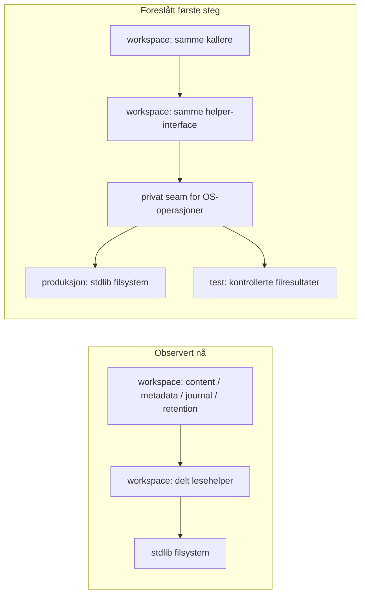

# AR01 — neste avgrensede arkitekturforbedring

**Anbefaling:** gjør den eksisterende fysiske lesekontrakten i workspace direkte
og deterministisk testbar. Behold `contentPhysical` / `contentReadBounded` og deres
kallere; samle implementasjonen i én lesefil og innfør bare den private OS-seam
som trengs for å teste filbytte og feilrekkefølge. **Ingen ny pakke anbefales nå.**
Dagens helper har allerede depth. Merverdien er en bedre testflate for denne
kontrakten, uten nye feilklasser, oversetting eller offentlig interface.
Dette er analyse, ikke en bestilling av forbedringen.

## Faktagrunnlag

AR01 analyserte Task-kopien av Epic `ply-agentic-workflow-support`, fra
`refs/heads/ply_agentic_workflow_support` ved
`/Users/perottochristensen/github/ply/ply_agentic_workflow_support`.
Task-base og observert Epic HEAD var begge
`f20b0a230d6268d5507eca691d5b105897f6e4b7`, tree
`bb3e3b83f7c346aa540e97170065ff1e6c5d7f7e`, 25.10.2026. Task-branch er
`ply-task/ar01-analyse-av-neste-pakke-og-arkitektu-0fb6381674b4`.
Kildereferansene gjelder denne basen; foreslåtte navn finnes ikke i koden.
WI01/SM01 er med i grunnlaget. Andre agenters filer og tjenester er urørt.

[WI01s ansvarskart](../workitem-core.md) stemmer med undersøkte kall:
workitem eier registrerte typer og relasjoner, workspace lagring og effekter,
workspaceview projeksjoner, taskrun/workflowhandoff utføring og levering.
Workitem beholder sin rene kjerne med kun `fmt` som import.

## Kandidater, rangert

Rangeringen er en faglig vurdering av nytte mot endringskostnad, ikke målt ytelse.

| Rang | Konkret kandidat | Merverdi utover dagens kode | Kostnad og valg |
| --- | --- | --- | --- |
| 1 | Direkte kontraktstester og privat OS-seam for eksisterende lesehelper [R1] | Deterministiske tester av faktisk filbytte, lesefeil og close-feil, uten full Task-/registerfixture. | Begrenser endringen til leselogikk og dens tester. Anbefales; bare filflytting alene er ikke leveransen. |
| 2 | Trekk samme helper ut til `internal/physicalread` | Selvstendig pakke kan håndheve importretning og teste uten å bygge workspace. | Algoritmen er allerede sentral. Nye feilklasser/adapteroversetting gir kompatibilitetskost; testseam trengs uansett. Ingen ny reell ekstern bruker er påvist. Behold dagens helper. |
| 3 | Task-innholdsdekoder / kompatibilitet som egen modul [R6] | Samler strict JSON, shape, versjonsvalg og semantikk bak ett interface. Virkelige kallere er `mutateTaskContent`, `readContentManifest` og `validateContentPublicationChain`. | Goal-/execution-schema og `deliveryAgreementRule` trekker med domeneregler. Større risiko for hash-/feilendring; et lite generisk decode-lag blir bare videresending. Utsett. |
| 4 | Felles request-observasjon for workspace/workflow-status [R7] | Kunne samle basis, livssyklus, kø og runs for lesekallere. | Status gjenbruker allerede inventory, og `ReadInventory` leser closeout-historikk én gang. Ny abstraksjon kan utviske freshness/eierskap uten påvist lesebesparelse. Utsett til et konkret hull er målt. |

## Verifiserte kilder og faktiske kallere

| Ref | Kilde på analysert base | Observert ansvar / bruk |
| --- | --- | --- |
| R1 | [task_content_store.go:45](../../internal/workspace/task_content_store.go#L45), `contentPhysical`; [samme fil:58](../../internal/workspace/task_content_store.go#L58), `contentReadBounded` | Absolutt/ren sti, EvalSymlinks, regular-file, valgfritt nøyaktig 0400, Lstat/Open/Stat/SameFile, limit+1, etterkontroll og close-feil. `ReadSource` kaller uten 0400; `TaskContentStorage.Read` krever 0400 og sjekker deretter digest. |
| R2 | [metadata_store.go:37](../../internal/workspace/metadata_store.go#L37), `readWorkspaceMetadata` | 16 MiB, uten 0400-krav; fravær håndteres før lesing, feil pakkes som metadata-/work-item-feil. |
| R3 | [task_journal.go:14](../../internal/workspace/task_journal.go#L14), `ReadTaskJournalBasis` | Leser work-items-registeret med 32 MiB-grense før dekoding og Task-/repo-bindingskontroll. |
| R4 | [task_closeout_retention.go:39](../../internal/workspace/task_closeout_retention.go#L39), `readCloseoutEvidence` | 64 MiB; locator/digest valideres før lesing, hash etterpå. Retention-oppløsning beholder eksakt historisk origin-/resultatbinding. |
| R5 | [content_observation.go:11](../../internal/workspace/content_observation.go#L11), `observeTaskContent`; [work_item_store.go:352](../../internal/workspace/work_item_store.go#L352), `validateClosure` | Kopierer og gjenbruker vellykkede bytes innen én fase. Ny snapshot/publish får ny observasjon. `systemWorkItemStoreSession.publish` sjekker kø før innhold; `validateClosure` gjør motsatt. |
| R6 | [task_content_schema.go:367](../../internal/workspace/task_content_schema.go#L367), `decodeTaskContent`; [task_content_compatibility.go:17](../../internal/workspace/task_content_compatibility.go#L17), `decodeStoredTaskContent` | Draft-invalid-input og lagret reader-incompatible er ulike kontrakter. `readContentManifest` krever også kanoniske bytes; registrert request-/publication-kjede kontrolleres separat. |
| R7 | [workflow_status.go:22](../../internal/workspaceview/workflow_status.go#L22), `ReadWorkflowStatusWithInventory`; [read_inventory.go:72](../../internal/taskrun/read_inventory.go#L72), `ReadInventory` | Status kombinerer registrert basis og prosesshistorikk. `internal/agentwork/native.go` bruker returnert inventory fra samme lesing. `CheckReadViewBasis` rapporterer unknown ved drift, ikke en transaksjonsgaranti. |
| R8 | [scanner_test.go:19](../../internal/architecture/scanner_test.go#L19), `modulePath`; [workitem_test.go:10](../../internal/architecture/workitem_test.go#L10), `TestWI01Architecture` | Eksisterende testlokal AST-scanner håndhever WI01-R1–R3, også i inaktive build-varianter. |

## Eksisterende depth og konkret merverdi

R1 er allerede én delt implementasjon med et lite interface. Sletting av en ny
pakke ville ikke spre kontrollene til leserne: dagens workspace-helper kunne
fortsatt samlet dem. Det er derfor ingen påvist deduplisering eller callerforenkling
å hente ved pakkeuttrekk. Bare å beholde helperen uendret er et forsvarlig nullalternativ.

Det avgrensede hullet er testbarhet inne i filobservasjonen. Kildesøk i workspace
sine `_test.go` fant ingen direkte kall til `contentReadBounded`/`contentPhysical`.
Det beviser ikke manglende indirekte dekning. Eksisterende
`TestTaskContentSourceHashAndSymlinkRejectedBeforePublication` tester blant annet
symlink og en `short_read`-variant, men sistnevnte injiserer feil ved `source-read`
**før** helperen åpner filen. Den prøver ikke lesefeil og close-feil inne i helperen.

**Konkret scenario:** en senere endring i descriptor-håndtering skal bevare at
(a) en vellykket lesing etterfulgt av close-feil returnerer både buffer og feil,
(b) read-feil ikke erstattes av close-feil, og (c) filbytte før/etter lesing avvises.
I dag kan en vanlig fysisk fixture ikke pålitelig fremtvinge alle disse feilene;
en samtidig filbytter gir ustabil timing, og `source-read`-faulten treffer feil sted.
En privat, parameterbundet adapter for OS-operasjonene lar små kontraktstester
styre dette deterministisk. De samme feilene testes gjennom helperens eksisterende
interface og frosne returer, uten Task-opprettelse, Goal/kø og Git-fixtures.

Dette øker ikke modulens eksterne depth; det gjør eksisterende depth billigere å
beskytte ved endring. Kostnaden er en liten intern seam og testadapter. Den skal
innføres bare for operasjonene disse scenariene krever, uten global hook, generelt
virtuelt filsystem eller offentlig konfigurasjon. Det er billigere enn kandidat 2,
som trenger samme seam i tillegg til nye feiltyper og oversetting. Kandidat 3/4
har større domeneomfang og mindre dokumentert gevinst i et første lite steg.

## Ansvar, dataeierskap og interface

Det eksisterende, private interface beholdes:

```go
func contentPhysical(path string) error
func contentReadBounded(path string, limit int, immutable bool) ([]byte, error)
```

Forslaget samler disse i `internal/workspace/content_physical_read.go`, med en
privat implementasjonsfunksjon som mottar de nødvendige OS-operasjonene per kall.
Den ordinære wrapperen leverer reelle OS-operasjoner; tester leverer kontrollerte
read/stat/close-resultater. Den eksakte interne formen bør velges ved implementasjon,
men ingen caller får et nytt argument, nytt feilformat eller ny avhengighet.
`contentPhysical` beholder også sine sti-/mappekallere i Git-/metadata-/closeout-kode.

Lesemodulen eier descriptor-livsløpet og bytebufferen, uten delt tilstand eller
cache. Workspace sine øvrige moduler eier som før limits, digest, kanonisering,
schema, Task-scope, feilpresentasjon, bindingskontroller og effekter.
`TaskContentError`, `contentError` og `firstError` brukes med samme semantikk;
ingen ny feilklasse eller unwrap-oversetting innføres. Interface omfatter også
rekkefølge, feil og bufferretur. `immutable` betyr kontroll av eksakt 0400, ikke
at eieren aldri kan endre filen igjen.

Konkret før/etter: `readWorkspaceMetadata` beholder fraværsbehandling,
`metadataStoreError` og 16 MiB uten 0400. `TaskContentStorage.Read` beholder
`managed-read`, mappesjekk, artsbestemt limit, digest og diagnostikk.
Endringen gjelder implementasjonens interne testseam, ikke kallernes atferd.



Dette er kall-/implementasjonskanter, ikke nye pakkeimporter. Pakkeavhengighetene
forblir workspaceview → workspace → workitem og taskrun/workflowhandoff → workspace;
workitem får ingen IO. Kartet utelater øvrige importer. Structurizr-viewene kan
senere synliggjøre R2–R4-kallerne og testseamen; ingen diagramleveranse kreves her.

## Bevarte invariants og risiko

| Tema | Kontrollpunkt for en senere implementasjon |
| --- | --- |
| JSON/YAML, binding og hash | Ingen ny lagringsplass, formatversjon, tag, locator, hash eller registermigrering. Historiske Epic-/Spec-/resultatbindinger beholdes. Hash og kanonisering flyttes ikke inn i helperen. |
| Fysisk observasjon | Behold absolutt/ren sti, symlink-avvisning, regular-file, valgfri 0400, før-/etteridentitet, størrelse/modtime, limit+1 og close. Dette er dagens best-effort observasjon, ikke atomisk snapshot eller en ny sikkerhetsgaranti. |
| Feilrekkefølge | Sti før type/modus, type/modus før lesing, limit før etterkontroll, close-feil bare når tidligere feil mangler. Behold buffer sammen med close-feil, eksakt feiltekst, errors.As/Is og unwrap. Ingen nye limit-regler, retries eller flytting av callerens fraværsbehandling. |
| Observasjonslevetid | R5 beholdes: root/kind/digest som cache-nøkkel, kopier av vellykkede reads, ingen cache over reread, låserverv eller publish. Testseamen har ingen cache eller delt hook. |
| Native partial/unknown/veto/no-replay | Leseutfall gir ingen fullmakt. Registry-replace, publish, sync, unlock og dispatch blir hvor de er. En lesefeil etter mulig effekt bevarer unknown; ingen automatisk ny publisering. Tekniske bevis blir ikke QA eller klarert veto. |
| Plattform og scope | Windows-/Unix-publisering og `platformSyncDirectory` blir utenfor. Task-scoped closure og full registerserialisering beholdes. Ingen migrering av taskrun sine annerledes fysiske lesere. |

## Liten migreringsplan og håndheving

1. **Frys kontrakten.** Legg til direkte tabelltester gjennom dagens helper for
   sti, symlink, filtype, valgfri 0400 og eksakt limit/limit+1. Disse kan allerede
   være grønne; det skal ikke oppgis en oppdiktet produktfeil eller RED.
2. **RED/GREEN for testseamen.** Skriv tester for read+close-feil, vellykket
   read+close-feil med buffer og før-/etterfilbytte gjennom den foreslåtte private
   implementasjonsfunksjonen. Første RED er manglende seam/testbarhet, ikke påvist
   feil i dagens algoritme. Innfør kun nødvendig parameterbundet seam og samle
   lesekoden i én fil. Gjør testene grønne uten semantisk endring.
3. **Kontroller kompatibilitet.** Kjør relevante regresjoner under, bygg berørte
   pakker, og bekreft samme feiltekst/klasse/unwrap og ingen nye filer. Avslutt
   her. Ekstern pakke og flere lesere krever en ny begrunnet vurdering.

Enforceable avhengighetsregler foreslås som små tillegg til eksisterende scanner [R8]:

- **AR01-R1:** Den foreslåtte lesefilen må finnes og ha begge helperne. Filen
  kan bare importere nødvendige stdlib-pakker (`fmt`, `io`, `os`, `path/filepath`);
  ingen Ply-/tredjepakke. Helperne defineres kun her. Dette er en filregel,
  ikke en påstand om at hele workspace blir uavhengig av domenekode.
- **AR01-R2:** Behold WI01-R1–R3 uendret, særlig forbudet mot workspace →
  workspaceview/taskrun/workflowhandoff og workitem sin fmt-regel. Lesekontrakten
  skal ikke flyttes inn i workitem for å oppnå pakkeisolasjon.
- Bruk scannerens samme AST/unquote, rekursive filpopulasjon og pakkegrenser,
  også OS-suffikser, genererte filer og inaktive build tags. Røde fixtures for
  manglende helper/fil, duplikat og ulovlig alias/dot/blank import må faktisk
  feile. Importregler beviser ikke fravær av skriving; test ingen nye filer og
  vurder effektfri implementasjon separat. Ingen ny arkitekturplattform.

Eksisterende regresjoner som en implementasjon må beholde:

| Eksisterende testfil | Navngitte relevante tester |
| --- | --- |
| [content_observation_test.go](../../internal/workspace/content_observation_test.go) | `TestWorkItemSnapshotReusesVerifiedContentWithinObservation`, `TestContentObservationOwnsBytesAndRetriesMissingSources`, `TestWorkItemObservationRejectsCorruptionOnNextSnapshotAndPublication` |
| [task_content_store_test.go](../../internal/workspace/task_content_store_test.go) | `TestTaskContentSourceHashAndSymlinkRejectedBeforePublication`, `TestTaskContentPublicationFaultsPreserveOutcomeAndExactRetry`, `TestTaskContentRegistrySyncAndUnlockFailuresRemainUnknown` |
| [project_metadata_test.go](../../internal/workspace/project_metadata_test.go) | `TestProjectMetadataRejectsCorruptionAndSymlinks` |
| [task_closeout_informative_test.go](../../internal/workspace/task_closeout_informative_test.go) | `TestCloseoutRetentionInformativeDocumentsAreOpaque` |
| [workitem_compatibility_test.go](../../internal/workspace/workitem_compatibility_test.go) | `TestWI01CompatibilityWire`, `TestWI01CompatibilityValidationOrderAndErrors` |
| [workflow_status_test.go](../../internal/workspaceview/workflow_status_test.go), [read_reuse_test.go](../../internal/taskrun/read_reuse_test.go) | `TestWorkflowStatusRepeatedReadsAreBatchedAndDoNotWrite`, `TestInventoryReadsCloseoutHistoryOnce` beskytter allerede eksisterende gjenbruk. |

## Utført verifikasjon og ytelse

På analysert kode kjørte AR01 `go test ./internal/workitem ./internal/architecture
-count=1` og åtte eksakte workspace-tester: de tre observasjonstestene, de tre
`task_content_store_test.go`-testene og de to WI01Compatibility-testene i tabellen.
Alle passerte. Øvrige tester er kildekontrollert og anbefalt for senere implementasjon,
ikke oppgitt som kjørt. Kildereferansene kontrolleres også av rapportens private
acceptance-entrypoint. Separat review og native kvalifisering er egne leveransesteg;
rapporten påstår ikke at senere gates allerede er passert.

Ingen elapsed-tider, IO-profiler eller produksjonsytelse er målt. Lesetellingene
i eksisterende tester beviser avgrenset gjenbruk, ikke lavere latenstid.
Anbefalingen beholder samme IO og har **ingen påstått hastighetsgevinst**.
Nyttehypotesen er deterministiske tester og lavere kost ved senere vedlikehold
av en delt kontrakt. Ved faktisk treghet kan frivillig request-/elapsed-logging
rundt `ReadWorkflowStatusWithInventory` eller closure-lesing skille registre,
innhold og runs. Dette er senere diagnostikk, uten dokumentbytes, ny
loggingplattform eller benchmarkrigg.
