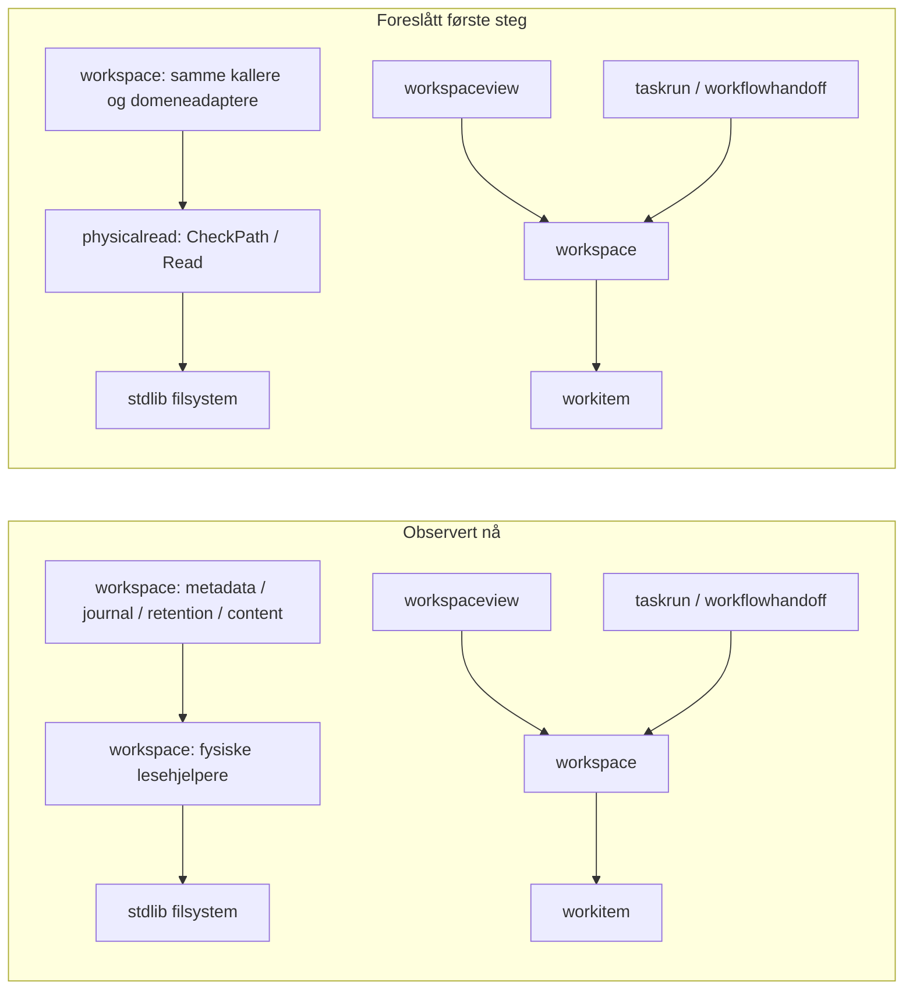

# AR01 — neste avgrensede arkitekturforbedring

**Anbefaling:** trekk dagens fysiske, begrensede fillesing ut til en liten
`internal/physicalread`-modul. Første steg omfatter bare `contentPhysical` og
`contentReadBounded`, med kompatible adaptere i workspace. Dette gjør en allerede
delt IO-kontrakt selvstendig testbar uten å flytte Task-/Goal-/Delivery-regler.
Rapporten bestiller ingen implementasjon eller ny Task.

## Faktagrunnlag

AR01 analyserte Task-kopien av Epic `ply-agentic-workflow-support`, fra
`refs/heads/ply_agentic_workflow_support` ved
`/Users/perottochristensen/github/ply/ply_agentic_workflow_support`.
Task-base og observert Epic HEAD var begge
`f20b0a230d6268d5507eca691d5b105897f6e4b7`, tree
`bb3e3b83f7c346aa540e97170065ff1e6c5d7f7e`, 25.10.2026. Task-branch er
`ply-task/ar01-analyse-av-neste-pakke-og-arkitektu-0fb6381674b4`.
Referansene nedenfor gjelder denne basen; foreslåtte navn finnes ikke i koden.
WI01/SM01 er med i grunnlaget. Ingen andre agenters filer eller tjenester er brukt.

[WI01s ansvarskart](../workitem-core.md) stemmer med undersøkte kall:
workitem eier registrerte typer og relasjoner, workspace eier lagring og effekter,
workspaceview projiserer, og taskrun/workflowhandoff håndterer utføring og levering.
Workitem skal fortsatt være den rene kjernen med kun `fmt` som import.

## Kandidater, rangert

Rangeringen er en faglig vurdering av nytte, avgrensning og semantisk risiko,
ikke et målt ytelsesresultat.

| Rang | Konkret kandidat | Nytte og kostnad | Vurdering |
| --- | --- | --- | --- |
| 1 | Fysisk lesing: `contentPhysical` / `contentReadBounded` [R1] | Ett lite interface skjuler sti-, filidentitets-, størrelses-, modus- og close-regler. Brukes allerede av innhold, metadata, journal og retention [R2–R4]. | Lite første steg; behold eksisterende adaptere og alle domenekontroller. |
| 2 | Hele `TaskContentStorage` og `observeTaskContent` [R1, R5] som innholdslagringsmodul | Skjuler også hash, mapper, publish-once, sync og faseavgrensede bytekopier. Reell depth, men berører writer-lås, fault-punkter, scope og plattform-sync. | Utsett. Vesentlig større feilflate enn lesedelen; eksisterende observasjon gir allerede gjenbruk. |
| 3 | Task-innholdsdekoder / kompatibilitet [R6] | Samler strict JSON, shape, versjonsvalg og semantikk. Flere virkelige kallere: `mutateTaskContent`, `readContentManifest`, `validateContentPublicationChain` og Goal-operasjoner. | Utsett. Goal-/execution-schema og `deliveryAgreementRule` trekker med domeneregler; et lite generisk decode-lag ville bare videresendt. |
| 4 | Felles request-observasjon for workspace/workflow-status [R7] | Kunne samle basis, livssyklus, kø og run-inventory. Men `ReadWorkflowStatusWithInventory` gjenbruker allerede inventory, og `ReadInventory` leser closeout-historikk én gang. | Utsett til måling viser et konkret hull. Ny snapshot-abstraksjon kan utviske freshness og domeneeierskap. |

## Verifiserte kilder og faktiske kallere

| Ref | Kilde på analysert base | Observert ansvar / bruk |
| --- | --- | --- |
| R1 | [task_content_store.go:45](../../internal/workspace/task_content_store.go#L45), `contentPhysical`; [samme fil:58](../../internal/workspace/task_content_store.go#L58), `contentReadBounded` | Absolutt/ren sti, EvalSymlinks, regular-file, valgfritt nøyaktig 0400, Lstat/Open/Stat/SameFile, limit+1, etterkontroll og close-feil. `ReadSource` kaller uten 0400; `TaskContentStorage.Read` krever 0400 og sjekker deretter digest. |
| R2 | [metadata_store.go:37](../../internal/workspace/metadata_store.go#L37), `readWorkspaceMetadata` | 16 MiB, vanlig fil uten 0400-krav. Fravær håndteres før lesingen; feil pakkes som metadata-/work-item-feil. |
| R3 | [task_journal.go:14](../../internal/workspace/task_journal.go#L14), `ReadTaskJournalBasis` | Leser work-items-registeret med 32 MiB-grense før dekoding, registrert Task og repo-binding kontrolleres. |
| R4 | [task_closeout_retention.go:39](../../internal/workspace/task_closeout_retention.go#L39), `readCloseoutEvidence` | 64 MiB; kaller validerer locator/digest før lesing og sjekker hash etterpå. Retention-oppløsning beholder eksakt historisk origin-/resultatbinding. |
| R5 | [content_observation.go:11](../../internal/workspace/content_observation.go#L11), `observeTaskContent`; [work_item_store.go:352](../../internal/workspace/work_item_store.go#L352), `validateClosure` | Samme vellykkede bytes gjenbrukes med kopier innen én fase. Ny snapshot/publish får ny observasjon. `systemWorkItemStoreSession.publish` sjekker kø før innhold; `validateClosure` gjør motsatt. |
| R6 | [task_content_schema.go:367](../../internal/workspace/task_content_schema.go#L367), `decodeTaskContent`; [task_content_compatibility.go:17](../../internal/workspace/task_content_compatibility.go#L17), `decodeStoredTaskContent` | Draft-invalid-input og lagret reader-incompatible er ulike kontrakter. `readContentManifest` krever dessuten kanoniske bytes; registrert request-/publication-kjede kontrolleres separat. |
| R7 | [workflow_status.go:22](../../internal/workspaceview/workflow_status.go#L22), `ReadWorkflowStatusWithInventory`; [read_inventory.go:72](../../internal/taskrun/read_inventory.go#L72), `ReadInventory` | Status kombinerer registrert basis og prosesshistorikk. `internal/agentwork/native.go` bruker returnert inventory fra samme lesing. `CheckReadViewBasis` rapporterer unknown ved drift, ikke en transaksjonsgaranti. |
| R8 | [scanner_test.go:19](../../internal/architecture/scanner_test.go#L19), `modulePath`; [workitem_test.go:10](../../internal/architecture/workitem_test.go#L10), `TestWI01Architecture` | Eksisterende testlokal AST-scanner håndhever WI01-R1–R3 og dekker også inaktive build-varianter. |

Dette er felles policy som allerede er implementert én gang, ikke påvist
duplisert IO. Problemet er eierskap og testflate: metadata/journal/retention
avhenger av en fysisk lesekontrakt plassert sammen med Task-publisering. Å fjerne
den foreslåtte modulen ville kreve at disse leserne igjen kjente alle
filkontrollene. Det gir depth, selv om bytealgoritmen beholdes.

## Forslag: ansvar og lite interface

Seam legges mellom fysisk observasjon og workspace sine innholds-/identitetsregler.
Forslag til interface, ikke implementert kode:

```go
type Options struct {
    MaxBytes        int
    RequireMode0400 bool
}
func CheckPath(path string) error
func Read(path string, options Options) ([]byte, error)
```

`CheckPath` bevarer bare dagens `contentPhysical`-kontrakt, også for mapper;
den garanterer ikke filtype eller lesbarhet. Eksisterende Git-/metadata-/closeout-
kallere av `contentPhysical` trenger denne operasjonen. `Read` utfører de samme
kontrollene og i samme rekkefølge som dagens `contentReadBounded`. Interface
inkluderer feilrekkefølge og byte-/feilretur, ikke bare Go-signaturene.

Modulen eier fysisk lesing, descriptor-livsløp og returnert bytebuffer, uten delt
tilstand eller cache. Workspace eier alle eksisterende grenser, kallere og
adaptere, samt digest, kanonisering, schema, Task-scope, feilpresentasjon,
bindingskontroller og effekter. `MaxBytes` kommer fra dagens konstanter;
det innføres ingen ny limit-validering eller policy i dette steget. `0400`
beskriver kontrollert filmodus, ikke en garanti mot at eieren senere endrer filen.

Modulen trenger en liten klassifisert feil for dagens egne avvik: ugyldig
input og integritetsavvik, med opprinnelig detaljtekst. Rene OS-/read-/close-feil
beholdes som årsaker. Workspace-adapterne oversetter til nøyaktig eksisterende
`TaskContentError`-kode, tekst og unwrap-atferd; de skal ikke legge til en ny
observerbar cause-kjede. `TaskContentDiagnosticValue` og `contentArtifactError`
blir i workspace. Dermed får ikke IO-modulen Task-skjema eller reader-capability
som skjult avhengighet. Dette er en nødvendig kompatibilitetsjobb, ikke gratis
flytting av to funksjoner.

Konkret før/etter: `readWorkspaceMetadata` beholder fraværsbehandling og
`metadataStoreError`; adapteren leser fortsatt med 16 MiB og uten 0400-krav.
`TaskContentStorage.Read` beholder `managed-read`, mappesjekk, artsbestemt limit,
digest og diagnostikk, men bruker lesemodulen via samme adapter. Kallerne får
ingen nye policyvalg. Gevinsten er locality og isolerte kontraktstester, ikke
færre metoder ved eksisterende kallesteder.



Kartet viser bare berørte kanter, ikke alle importer. Første steg gir kun
workspace → physicalread; workspaceview/taskrun/workflowhandoff skal ikke begynne
å importere den nye modulen direkte. Workitem får ingen IO-avhengighet.
Structurizr-viewene kan senere synliggjøre dette ansvaret og R2–R4-kallerne;
de er ingen forutsetning for anbefalingen.

## Semantikk og risiko som må bevares

| Tema | Kontrollpunkt for en senere implementasjon |
| --- | --- |
| JSON/YAML og lagrede bindinger | Ingen ny lagringsplass, formatversjon, tag, hash, locator eller registermigrering. Eksisterende historiske Epic-/Spec-/resultatbindinger beholdes. `CheckPath` skal fortsatt avvise urene/relative og oppløste symlink-stier. |
| Filobservasjon | Behold regular-file, 0400 kun der bestilt, før-/etteridentitet, størrelse og modtime, limit+1 og close-feil. Dette er dagens best-effort observasjon, ikke atomisk snapshot eller en ny sikkerhetsgaranti. Ikke legg inn retries som leser forbi den første feilen. |
| Feilrekkefølge | Frys inputfeil før filtilgang, fysisk sti før type/modus, type/modus før lesing, størrelse før etterkontroll, og close-feil bare når tidligere feil mangler. Behold også eventuell bytebuffer sammen med close-feil. Ikke flytt callerens hash-/fraværskontroll inn i modulen. |
| Observasjonslevetid | Behold `observeTaskContent` og cache-nøkkel root/kind/digest; bare vellykkede reads caches, bufferkopier hindrer forgiftning. Aldri gjenbruk over reread, låserverv eller publish. Ingen cache i physicalread. |
| Native partial/unknown/veto/no-replay | Lesing gir ingen ny effektfullmakt. Publisering, registry-replace, sync og unlock blir hvor de er. En lesefeil etter en mulig effekt må fortsatt bevare unknown; aldri automatisk ny publisering eller dispatch. Tekniske bevis blir ikke menneskelig QA eller klarert veto. |
| Plattform og scope | Behold `platformSyncDirectory` og Windows-/Unix-publisering utenfor. Behold scoped closure og hele registerserialiseringen; ingen flytting av Task-/kø-eierskap til IO-modulen. Ingen utrulling til taskrun sine annerledes fysiske lesere. |

## Liten migreringsplan og håndheving

1. **Frys kontrakten før flytting.** Skriv og kjør røde tester for den nye
   modulens manglende interface og adapter-kompatibilitet. Bruk faste forventninger
   fra dagens atferd, ikke to implementasjoner som tilfeldigvis er enige.
2. **Flytt kun lesing.** Innfør modulen og behold `contentPhysical` /
   `contentReadBounded` som kompatible workspace-adaptere. Koble alle deres
   eksisterende kallere uten å endre caller-rekkefølge, limits eller fault-punkter.
   Helpers som `firstError` erstattes internt bare med samme første-feil-atferd.
   Ikke flytt `TaskContentStorage`, observasjon, path-layout eller publisering.
3. **Gjør kontrakt og arkitekturregler grønne.** Kjør testene nedenfor og bygg
   berørte pakker. Kontroller eksakt wire-/hash-/diagnostikk og at lesing ikke
   skaper filer. Avslutt her; full innholdspakke eller flere brukere krever egen vurdering.

Utvid eksisterende testlokale scanner [R8], uten ny plattform:

- **PR-R1:** `internal/physicalread` og underpakker får bare importere eksplisitt
  nødvendige stdlib-pakker (`errors`, `fmt`, `io`, `os`, `path/filepath`), ingen Ply-
  eller tredjepakker. Det forhindrer avhengighet tilbake til workspace.
- **PR-R2:** Av Ply-produksjonspakker får bare workspace og modulen selv importere
  physicalread, inkludert underpakker. Kallere i andre lag må gå via domeneeier.
  WI01-R1–R3 beholdes uendret.
- Bruk samme rekursive filpopulasjon, AST/unquote og presise pakkegrenser som WI01,
  også genererte filer, OS-suffikser og inaktive build tags. Den nye pakken må
  finnes og ha produksjonsfiler; tom scan er feil. Røde fixtures dekker reverse
  import, ulovlig caller/underpakke og blank/dot/alias-import; lignende pakkenavn
  skal ikke feilklassifiseres. Importregler beviser ikke fravær av skriving;
  lesingens effektfrihet må vurderes og testes særskilt.

Minste nye RED/GREEN-dekning er tre grupper: (a) tabell for fysisk sti, symlink,
filtype, 0400-valg og eksakt limit/limit+1; (b) deterministisk før-/etterbytte,
kortlesing, størrelse/modtime og close-feil med første-feil-/bytekontrakt;
(c) adapterens eksakte feilklasse/tekst/unwrap samt ingen nye filer. For (b)
brukes private testseams for eksisterende OS-operasjoner, ikke et nytt offentlig
filsystem-interface med bare én produksjonsadapter. Ikke utvid algoritmens garantier.

Eksisterende regresjoner som en implementasjon må beholde:

| Eksisterende testfil | Navngitte relevante tester |
| --- | --- |
| [content_observation_test.go](../../internal/workspace/content_observation_test.go) | `TestWorkItemSnapshotReusesVerifiedContentWithinObservation`, `TestContentObservationOwnsBytesAndRetriesMissingSources`, `TestWorkItemObservationRejectsCorruptionOnNextSnapshotAndPublication` |
| [task_content_store_test.go](../../internal/workspace/task_content_store_test.go) | `TestTaskContentSourceHashAndSymlinkRejectedBeforePublication`, `TestTaskContentPublicationFaultsPreserveOutcomeAndExactRetry`, `TestTaskContentRegistrySyncAndUnlockFailuresRemainUnknown` |
| [project_metadata_test.go](../../internal/workspace/project_metadata_test.go) | `TestProjectMetadataRejectsCorruptionAndSymlinks` |
| [task_closeout_informative_test.go](../../internal/workspace/task_closeout_informative_test.go) | `TestCloseoutRetentionInformativeDocumentsAreOpaque` |
| [workitem_compatibility_test.go](../../internal/workspace/workitem_compatibility_test.go) | `TestWI01CompatibilityWire`, `TestWI01CompatibilityValidationOrderAndErrors` |
| [workflow_status_test.go](../../internal/workspaceview/workflow_status_test.go), [read_reuse_test.go](../../internal/taskrun/read_reuse_test.go) | `TestWorkflowStatusRepeatedReadsAreBatchedAndDoNotWrite`, `TestInventoryReadsCloseoutHistoryOnce` beskytter eksisterende gjenbruk; dette er ikke en ny cache-bestilling. |

## Verifikasjon og ytelsespåstander

På analysert kode kjørte AR01 `go test ./internal/workitem ./internal/architecture
-count=1` og åtte eksakte workspace-tester: de tre observasjonstestene, de tre
`task_content_store_test.go`-testene og de to WI01Compatibility-testene i tabellen.
Alle passerte. Øvrige tester ovenfor er kildekontrollert og anbefalt for en senere
implementasjon, ikke oppgitt som kjørt her. Kildereferansene kontrolleres også i
rapportens private acceptance-entrypoint. Separat review og native kvalifisering
er senere leveransesteg; denne teksten påstår ikke at de allerede er passert.

Ingen elapsed-tider, IO-profiler eller produksjonsytelse er målt. Lesetellinger
i eksisterende tester beviser avgrenset gjenbruk, ikke lavere latenstid. Første
steg beholder samme IO og har **ingen påstått hastighetsgevinst**. Nyttehypotesen
er enklere isolerte tester og mer lokalt vedlikehold. Ved senere treghet kan
taktisk request-/elapsed-logging rundt `ReadWorkflowStatusWithInventory` eller
closure-lesing skille tid i registre, innhold og runs. Det er frivillig senere
diagnostikk, uten dokumentbytes, ny loggingplattform eller benchmarkrigg.
