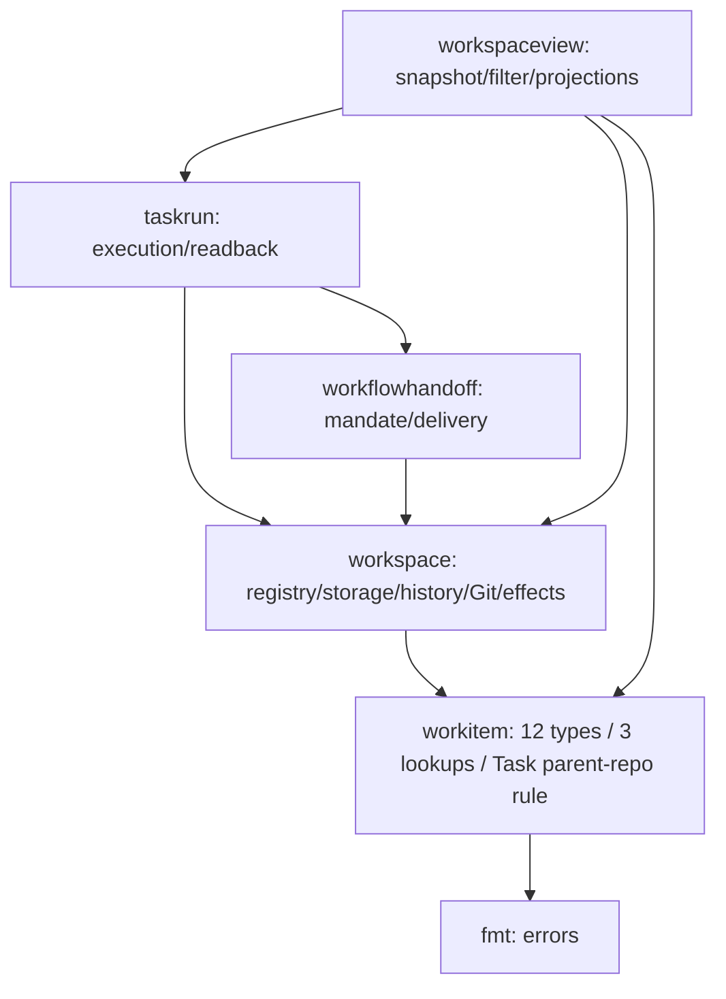

# WI01 — avgrenset workitem-kjerne

Forfatteroppdrag: **T2657F044**. Implementasjons-Spec basert på Ply-kandidat
`1cabaa8bba465f171f4a0ffef38844712c080cde` (2026-10-24).
Mål: samle registrerte Task/Epic-data og eksisterende relasjonsatferd i en liten,
syklusfri Go-modul med forståelig ansvar og regler håndhevet av vanlige tester.

## Scope

Flytt de tolv typene nedenfor, tre oppslag og de to eksisterende Task-parent/repo-
kontrollene til `internal/workitem`. Behold kompatibilitetsaliaser i workspace.
Bruk kjernen fra workspace og én eksisterende workspaceview-leseflyt.
Legg til avgrensede arkitekturtester og et lesbart ansvarskart i Ply-repoet.
Ingen generell arkitekturplattform eller videre domenekartlegging inngår.

`WorkItemRegistry`, operasjonshistorikk, formatversjoner, YAML, låser, Git,
kø, Spec-/resultathistorikk, integrasjon og levering blir i workspace.
Tidslogging/request-spans, taskcontent-uttrekking, ytelsesoptimalisering,
registermigrering og endring av writer-/cleanup-grenser er utenfor.
Herdr, plyapp, ply-crap, diagramgeneratorer og andre prosjekter endres ikke.
Historiske konsument-/PWA-/cleanup-Runs gjenopptas ikke.

## Inspected code

Referanser gjelder forfatterens inspiserte kandidat; finn symbolene igjen ved implementasjon.

| Kode | Observasjon og konsekvens |
| --- | --- |
| [work_item.go](../../internal/workspace/work_item.go), typer fra linje 25 og `findEpic`/`findTask`/`findEpicRepo` fra 568 | Tolv typer med ProjectID/RepoID; oppslag returnerer peker til slice-element og indeks, ikke kopi. |
| [project.go](../../internal/workspace/project.go), `ProjectID`, `RepoID` | Disse identitetene inngår i kjernedata. Flytt definisjonene; parsing og ProjectRecord/RepoRecord blir her. |
| [work_item_store.go](../../internal/workspace/work_item_store.go), `validateWorkItemRegistry` fra 860 | Task-løkken sjekker parent Epic/Project og repo/common-dir før operasjonstilstand. Trekk ut akkurat disse to kontrollene. |
| [registry_compatibility.go](../../internal/workspace/registry_compatibility.go), `classifyRegistryDecode` og `decodeRegistryNode` | Formatdiagnostikk og refleksjonsbasert YAML-kontroll blir lagringsansvar. |
| [read_view.go](../../internal/workspace/read_view.go), `ReadViewBasis` | Bruker `SnapshotRegistrations`, ikke full historisk closure; dette skillet bevares. |
| [snapshot.go](../../internal/workspaceview/snapshot.go), `ValidateTaskFilters` | Epic-filterets håndskrevne eksistensløkke erstattes med kjernens `FindEpic`. Prosjekt/repo-filtre blir uendret. |
| [epics.go](../../internal/workspaceview/epics.go), `epicsFromTasks` | Gjenværende workspace-avhengighet for lifecycle, registrerte baser og aktivitet. |
| [worktrees.go](../../internal/workspaceview/worktrees.go), `inventoryOwners` | Registrert eierskap kombineres med closeout, operasjoner og Git-inventory; flyttes ikke til kjernen. |
| [read_trace.go](../../internal/taskrun/read_trace.go) og [types.go](../../internal/workflowhandoff/types.go) | Faktiske workspace-kallere beholder typer via aliaser; ingen bred omskriving. |
| [entry_boundary_test.go](../../cmd/entry_boundary_test.go) | Eksisterende Go-parser/AST-mønster kan gjenbrukes som teknikk, uten nytt rammeverk. |
| [work_item_store_test.go](../../internal/workspace/work_item_store_test.go) og [read_view_test.go](../../internal/workspace/read_view_test.go) | Eksisterende determinisme-, streng dekoding- og leseisolasjonstester skal fortsette å passere. |

## Core interface

Kanoniske definisjoner i `internal/workitem/model.go`:

- `ProjectID`, `RepoID`, `EpicID`, `TaskID`, `WorktreeID`, `WorktreeOperationID`.
- `WorkItemState` med de fem eksisterende `WorkItem*`-konstantene og verdiene.
- `EpicWorktreeBinding`, `EpicRepoBinding`, `EpicRecord`, `TaskWorktreeBinding`, `TaskRecord`.

Dette er tolv typer totalt. `WorktreeOperationID` er en identitet brukt i bindingen;
`WorktreeOperationRecord` og `WorktreeObservationRecord` blir i workspace.
ProjectID/RepoID eies her fordi kjernedata trenger dem, mens workspace peker inn
til kjernen. Det krever verken motsatt import, dupliserte modeller eller types/utils-pakke.

```go
func FindEpic(epics []EpicRecord, id EpicID) (*EpicRecord, int)
func FindTask(tasks []TaskRecord, id TaskID) (*TaskRecord, int)
func FindEpicRepo(epic EpicRecord, repoID RepoID) (*EpicRepoBinding, int)
func ValidateTaskParent(task TaskRecord, epic *EpicRecord) error
```

Oppslag beholder første treff, `nil, -1` ved fravær og peker til opprinnelig
slice-element ved treff. Ingen cache, sortering, kloning eller skjult validering.
En peker må ikke beholdes gjennom append/reallokering av underliggende slice.
Workspace sine tre private `find*`-funksjoner blir tynne kompatibilitetskall.

`ValidateTaskParent` avviser nil Epic, feil Epic-ID eller ProjectID med eksisterende
`Task %s has invalid Epic/Project reference`, og fraværende repo eller ulik
GitCommonDir med `Task %s has invalid repository binding`. Epic-ID-sammenligningen
gjør kontrakten eksplisitt; dagens kall finner allerede Epic med Task.ParentEpicID.
Feil er ordinære formaterte feil, uten ny eksportert feiltype.
I workspace kalles funksjonen på samme sted som dagens to kontroller.
Behold repo-oppslaget som trengs av etterfølgende operasjonssjekker.
Dette samler ekte relasjonsatferd sammen med data, uten å flytte historikken.

Workspace eksporterer `type TaskRecord = workitem.TaskRecord` og tilsvarende for
alle tolv navn, samt konstantaliaser for tilstandene. Parsing, ID-generering,
`WorkItemError`, `WorkInvalidArguments` og deres feilklasser blir i workspace.
Workspaceview importerer workitem direkte og bruker `FindEpic` i
`ValidateTaskFilters`; behold eksisterende `notFound`-feil, JSON og leseatferd.

## Validation split

| Lag | Kontroller etter uttrekkingen |
| --- | --- |
| workitem, rent registrert modellforhold | Task peker på riktig Epic/Project og Epicens repo/common-dir. Ingen fil-/Git-oppslag eller formatkunnskap. |
| workspace, registrering/format | ID-/tekstsyntaks, sorterte unike arrays, feltform, null/arrays, bindingers syntaks og eierfelt, formatavhengig `ply_created`, ressurskollisjoner og formatgrenser. |
| workspace, historikk | Operasjonstilstand/digest, adoption/release, exact observation, historiske Epic-baser, lifecycle, resultater, QA, kø og Spec-kjeder. |
| workspace, lagring/live | YAML-dekoding og feilklassifisering, låser/publisering/closure, path-/Git-observasjon, actual effects og friskhet. |

Flytt ikke hele `validateWorkItemRegistry`, og kall ikke den nye kontrollen som en
ny tidlig prepass: behold eksisterende kontrollrekkefølge og første synlige feil.
Et parent OID/tree kan være en gyldig historisk base selv om nåværende base har
flyttet seg; ingen ny sammenligning med nåværende Epic OID/tree innføres.
`SnapshotRegistrations` beholder registreringskontroll uten full closure;
`Snapshot`, mutasjoner og scoped closure beholder sine sterkere kontroller.

## Compatibility

Behold felter, feltrekkefølge, YAML/JSON-tags, null/omitempty og nil/tomme slices
nøyaktig. Eksempel: EpicRecord.ID er `yaml:"id" json:"epic_id"`, TaskRecord.ID
har `json:"task_id"`. Ingen nye Marshal-metoder eller modellnormalisering.
`RawSHA256` fortsetter å binde leste registerbytes; `intentDigest` og canonicaljson
blir i workspace. Pakkeflyttingen gir ingen påstand om ytelsesgevinst.

Før flytting: lag faste, ikke selvavledede fixture-forventninger for ikke-tomme
Task/Epic/bindinger (inkludert nil Worktree og bound Worktree), JSON og YAML,
register-reencoding og operasjonens intentdigest. Test både eldre format 1/2 og
representativ nyere registrering med historisk base/adoption; gjenbruk eksisterende
journey-fixtures. Sammenlign feiltekst, `errors.As` til WorkItemError/
RegistryDiagnostic, klasse og unwrap der relevant for ugyldig parent/repo,
operasjon og format. Ikke krev stabilitet i `reflect.Type.PkgPath` eller `%T`:
kanonisk Go-pakkeeierskap endres med hensikt, serialisert data og feilsemantikk bevares.

## Architecture rules

Legg testene i `internal/architecture/*_test.go`, kjørt av **`go test ./...`**.
En liten testlokal scanner er nok; ingen nye produksjonsavhengigheter.
Modulens reelle importprefiks er `github.com/devdimensionlab/plybuild`.

| Regel | Produksjonskode som kontrolleres |
| --- | --- |
| WI01-R1 | Hele `internal/workitem` kan bare importere stdlib `fmt`. Ingen andre stdlib-, Ply- eller tredjepakker, heller ikke underpakker. Dette begrenser importavhengigheter; det beviser ikke fravær av IO, siden blant annet `fmt.Print` skriver. Implementasjonen bruker `fmt` kun til feilbygging med `fmt.Errorf`; ingen generell purity-plattform innføres. |
| WI01-R2 | `internal/workspace` kan ikke importere `internal/workspaceview`, `internal/taskrun` eller `internal/workflowhandoff`, inkludert underpakker. Workspace/workspaceview kan importere workitem. Eksisterende taskrun/workflowhandoff → workspace bevares. |
| WI01-R3 | De tolv reserverte typenavnene defineres bare i `internal/workitem`. Utenfor kjernen tillates bare workspace sine direkte aliaser til korrekt workitem-navn. Definisjon, struct-kopi, `type TaskID workitem.TaskID` og alias til feil mål avvises. Hver kanonisk type og hvert av de tolv workspace-aliasene må finnes. |

Scanneren går rekursivt over repoets `.go`-filer uten GOOS-, GOARCH- eller build tags-
filtrering. Inkluder generert produksjonskode, OS-suffikser og gjensidig utelukkende
build-tag-filer; parse hver fil selvstendig, ikke som én kompilert variant.
Ekskluder `_test.go`, `.git`, `vendor`, `testdata` og dokumentert byggeoutput `target`.
Bruk samme produksjonsdekning for import- og typeanalyse. Teststøtte og bevisst
ulovlige fixtures ligger bare i `_test.go`/`testdata`, aldri som produksjonsunntak.
Avvis nested go.mod i produksjonsscan med presis feil fremfor å hoppe over kode.

Bruk parser/AST, `strconv.Unquote(ImportSpec.Path.Value)` og faktiske importstier;
vanlig alias, dot og blank import gir samme regel. Prefikssjekk matcher bare lik sti
eller `sti + "/"`, ikke navn som tilfeldigvis begynner likt. Identifiser typealias
med `TypeSpec.Assign.IsValid()`; løs RHS-selector mot filens importtabell.
Workspace sine kompatibilitetsaliaser skal bruke kvalifisert import, ikke dot-import.
Skill importanalyse fra aliasanalyse: alle importformer omfattes av R1/R2.

Walk-/lese-/parse-/unquote-feil er testfeil. Manglende rot, manglende berørt pakke,
eller null produksjonsfiler i workitem/workspace/workspaceview/taskrun/workflowhandoff
skal feile. Kontroller at alle tolv typer faktisk er funnet; tom scan er ikke grønn.
Rapporter deterministisk sortert `fil:linje:kolonne`, regel-ID, importerende pakke,
faktisk importsti eller typenavn/aliasmål. Vis alle funn, ikke bare første.
Reglene beskytter navngitt eierskap, ikke strukturell likhet for vilkårlig omdøpte DTO-er.

## Scanner fixtures

Test scannerfunksjonene mot små midlertidige repo-fixtures (med eksplisitte
forventninger til regel, sti og linje), ikke ved å skade produksjonstreet:

- Lovlig fixture: fmt i kjernen, de tolv definisjonene, workspace-aliaser, og
  workspace/workspaceview → workitem samt taskrun/workflowhandoff → workspace.
- Ulovlig fixture: workitem → workspace, `os`, `os/exec`, `net/http`, tredjepakke
  og `unsafe`; prøv vanlig import, alias, dot og blank.
- Ulovlig fixture: workspace → hver av de tre forbudte pakkene og en underpakke;
  lovlig fixture med lignende, men ulikt pakkenavn tester prefiksavgrensning.
- Ulovlig fixture: en kopi eller ny navngitt type, alias til feil mål og manglende
  kanonisk type/kompatibilitetsalias; lovlig kvalifisert importalias testes også.
- Ulovlige import-/type-fixtures under Windows-/Linux-suffiks og inaktiv custom
  build tag oppdages på vertsmaskinen. Generert fil omfattes også.
- Fixture for manglende/tom pakke, ugyldig Go, nested modul og injisert walk-/read-
  feil feiler tydelig. Test fixture med lovlig `_test.go`/`testdata`-støtte for å
  dokumentere eksklusjonene. Ingen ekstern diagramserver eller verktøy kreves.

## Responsibility and callers

Pil betyr import fra kaller til eier. Implementert WI01-kart med observerte
importkanter, navngitte kallere og ansvar finnes i
[workitem-core.md](../workitem-core.md). Kartet under viser de observerte
importene mellom de fem berørte pakkene, samt kjernens fmt-import; øvrige
importer ligger utenfor dette avgrensede kartet.



Ved implementasjon oppdateres kartet til observerte importer og navngitte kall:
`findEpic/findTask/findEpicRepo` → kjerneoppslag, `validateWorkItemRegistry` →
`ValidateTaskParent`, `ValidateTaskFilters` → `FindEpic`. Forklar fortsatt
workspace-avhengighet i `LoadSnapshot`, `epicsFromTasks` og `inventoryOwners`.
Behold diagramkilden og en ren teksttabell som kan leses uten localhost-server.

Ingen offentlig Go-importdiagramkommando ble funnet i Ply-koden eller installert
`go2structurizr` i forfatterens PATH; `cmd/plugin_diagrams.go` håndterer eksisterende
Structurizr-eksport, ikke Go-importanalyse. Implementereren bruker eksisterende
public importdiagramstøtte dersom den faktisk er tilgjengelig, med dokumentert
kommando/versjon og avgrenset output. Ellers er AST-scannens observerte
importkantliste og dette lille ansvarskartet tilstrekkelig. Ingen generatorutvikling,
installasjon eller ekstern server er en testforutsetning.

## Implementation sequence

1. Skriv og kjør røde tester for manglende workitem-kjerne og scannerregler.
   Frys eksisterende wire-/hash-/feil-fixtures før produksjonsflyttingen.
2. Flytt tolv typer og tilstander; innfør workspace-aliaser. Flytt de tre oppslagene
   og Task-parent/repo-kontrollen. Koble eksisterende workspace-kall og Epic-filteret.
3. Gjør reglene og deres lovlige/ulovlige fixtures grønne, oppdater kartet og kjør
   kandidatbundne fokuserte tester etter WI01-verifikasjonsaddendumen nedenfor.
   Rett konkrete regresjoner innen dette scope. Arkitekturreglene inngår fortsatt
   i vanlig `go test ./...`; en grønn generell fullsuite er ikke leveranseport.

## Acceptance criteria

### WI01-AC01 — modell og kompatible kallere

Alle tolv typer eies av workitem; workspace-aliaser og eksisterende kallere
kompilerer. Alle fem tilstandsverdier og alle felt/tags er bevart.

### WI01-AC02 — nyttig, ren atferd

Tester dekker treff/fravær/første treff og mutasjon via returnert peker for alle
tre oppslag, samt gyldig parent/repo, manglende/feil Epic, ulik ProjectID,
manglende repo og ulik GitCommonDir. Workspace og Epic-filterets workspaceview-
leseflyt bruker kjernen; eksisterende not-found- og lesetellingtester passerer.

### WI01-AC03 — data, hash og feil

Faste fixture-forventninger i Compatibility passerer. Historisk parent-base kan
avvike fra nåværende base. Ugyldig operasjon/format avvises fortsatt, og første
feil bevares når flere feil finnes. Ingen formatoppgradering eller nye effekter.

### WI01-AC04 — håndhevede arkitekturregler

R1–R3 kjøres med vanlig `go test ./...`; produksjonsscanningen og samtlige
Scanner fixtures har observerte forventede resultater og presise diagnostikker.

### WI01-AC05 — forståelig visualisering

Repoet inneholder oppdatert diagramkilde, tekstlig ansvar/kallertabell og observerte
importkanter, med forklaring av gjenværende workspace-avhengigheter og forskjellen
på faktisk import og tillatt retning. Kan leses uten server.

### WI01-AC06 — teknisk verifikasjon

Kandidatbundne core-/scanner-tester med lovlige og ulovlige fixtures,
WI01Compatibility og relevante registrerings-/read-view-/filter-/historisk-base-/
adoption-/scoped-content-tester er faktisk kjørt og passerer. De seks navngitte
CLI-/schema-testene kjøres med eksakt privat kandidat og eksisterende schema-Python;
berørte pakker bygges/vettes, og dokumentets observerte importkanter kontrolleres.
Se [fokusert verifikasjon](../workitem-core.md#focused-verification) for kommandoene.
Acceptance-entrypoint kjører meningsfulle kontroller uten provider credentials.
Kontrollbevis kan foreligge før rapportretur; senere review, kvalifisering og
integrasjon er ikke tekniske forhåndsvilkår her.

Verifikasjonsaddendumen av 25.10.2026 erstatter bare det tidligere generelle
fullsuitekravet her og i Implementation sequence. Forgjenger-Run
`wfr_6ae5012d784ef46160ec84a3baf362deb607a8953b2abb0ee93af1bc78e81b86`
er retired med faktisk `failed` / `not_qualified` / `not_delivered` bevart.
Den brede kjøringen feilet på en urelatert InstallAuthority-fixture som forventet
exit 0 ved `owner_handoff`/exit 5, manglende Python-forutsetning i
ParallelPrivateCandidate og timeouts i store legacy-suiter. Ingen gammel aksept
eller review arves. Ingen ny generell fullsuite eller urelatert lifecycle-reparasjon
inngår i WI01; alle øvrige produktkrav og arkitekturregler gjelder uendret.

### WI01-AC07 — avgrenset scope

Endringene holder seg til avtalt scope, uten utvidelser til utelatt funksjonalitet,
andre prosjekter, gamle Runs eller generell arkitektur. Delivery eier senere
integrasjon og installasjon; utført levering er ikke et teknisk forhåndsvilkår.

## Delivery

Root registrerer/starter en ny implementasjons-Task gjennom installert native Ply
fra eksisterende project `ply` / repo `ply` / Epic `ply-agentic-workflow-support`.
Denne Specen starter ingen utvikling. Bruk stående Codex-backup under bevart
Claude-kvotestopp til 25. oktober kl. 17 Europe/Oslo; ingen kvoteprobe, upgrades,
interne subagenter eller direkte Herdr-agentstart.

Etter rapportretur krever Delivery separat native review/fiks og automatisk
verifikasjon som kvalifiserer samme rene commit/tree før integrasjon.
Implementasjonsløpet tillater Task-commits og deretter `local_epic_integration` til
`refs/heads/ply_agentic_workflow_support` ved
`/Users/perottochristensen/github/ply/ply_agentic_workflow_support`.
Ingen ekstra menneskelig QA-port, push/PR/master- eller hel-Epic-levering.
Bevar per-action runtime-kontroll og faktiske avslag/ukjente effekter.
Ved observert integrasjon med `owner_handoff` returnerer eieren til Root;
koordinatoren følger opp native cleanup.

Utvikleren bygger privat kandidat med `make build PLY_BUILD_OUTPUT=/absolute/private/ply`,
sjekker `version --format json` og `go version -m`, og bevarer kvalifiserte bytes.
Root eier senere kvalifisert ordinær CLI-installasjon med backup og relevant
installert smoke. Utvikleren installerer ikke globalt. Root eier også samlet
ply-log-varsling og videre oppfølging; forfatter/utvikler/reviewer returnerer til Root.
