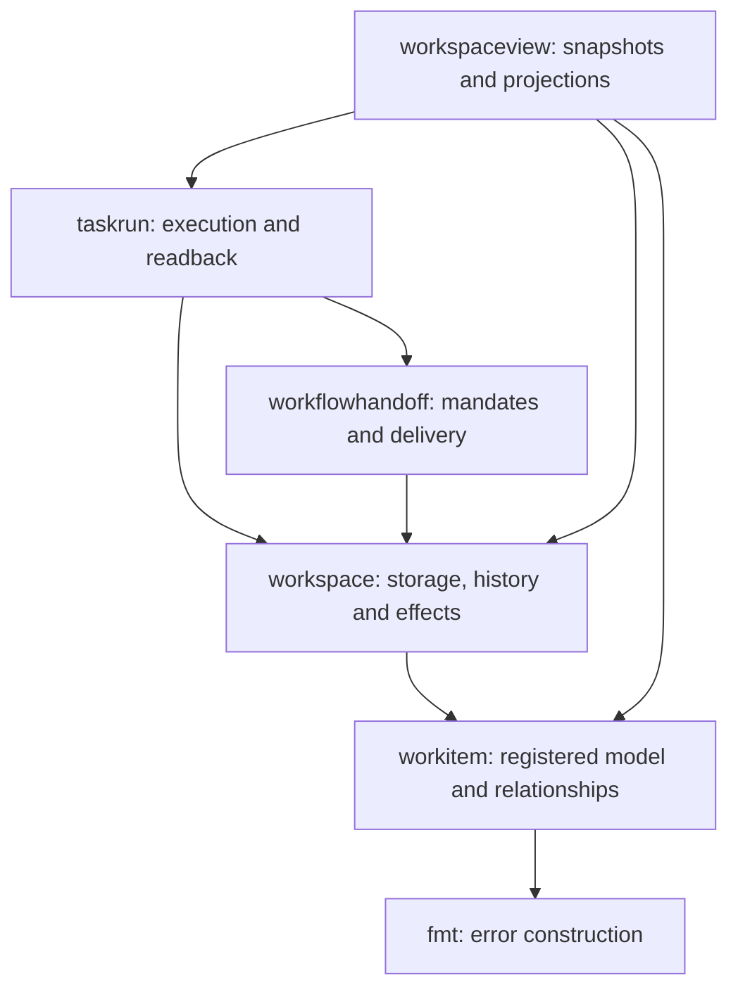

# WI01: registered workitem core

`internal/workitem` owns twelve types: ProjectID, RepoID, EpicID, TaskID,
WorktreeID, WorktreeOperationID, WorkItemState, EpicWorktreeBinding,
EpicRepoBinding, EpicRecord, TaskWorktreeBinding and TaskRecord. Workspace
retains direct compatibility aliases and the five state constant aliases.

The core also owns the three slice lookups and Task parent/repository validation.
Lookups return the first element's address and index, or `nil, -1`. Returned
pointers alias the original slice and must not survive append/reallocation.
Parent validation checks Epic ID, Project ID, repository presence and Git common
directory. It does not check current Git state, syntax or historical base OIDs.

## Observed responsibilities and callers

| Caller | Owner / behavior consumed | Responsibility retained by caller |
| --- | --- | --- |
| workspace `findEpic` | workitem `FindEpic` | Registry selection and store boundaries |
| workspace `findTask` | workitem `FindTask` | Registry selection and store boundaries |
| workspace `findEpicRepo` | workitem `FindEpicRepo` | Registry selection and operation checks |
| workspace `validateWorkItemRegistry` | workitem `ValidateTaskParent` | Existing validation order, first error, formats, operations, history and exact observations |
| workspaceview `ValidateTaskFilters` | workitem `FindEpic` | Filter validation and existing WorkItemError/not-found response |
| workspaceview `LoadSnapshot` | workspace `ReadViewBasis`, lifecycle and closeout readers | One registration snapshot, lifecycle subject checks and freshness |
| workspaceview `epicsFromTasks` | workspace registered bases, activity and lifecycle | Projection, child progress counts and current recorded bases |
| workspaceview `inventoryOwners` | workspace repo records, registered bases, Task/operation records and closeouts | Combine ownership with Git inventory; retired/removed worktrees do not claim reused paths |
| taskrun | workspace records/readback; workflowhandoff records | Execution and read trace; compatibility names remain usable |
| workflowhandoff | workspace records, stores and delivery behavior | Mandate, qualification and delivery orchestration |

Workspace retains WorkItemRegistry, parsing/ID generation, formatted errors,
YAML/JSON storage, canonical intent hashes, operation/adoption/release records,
queue/Spec/result history, locks, Git and effects. `SnapshotRegistrations` retains
registration validation; full snapshots, mutations and scoped closure retain
stronger history/artifact checks. A Task's historical base may differ from the
current Epic base. This extraction changes neither persistence nor authority.

## Actual imports

Arrows mean caller imports owner. All arrows below are observed production
imports among these five packages, plus the core's sole standard library import.
Other imports of the larger packages are outside this bounded map.



Observed AST edge list (module prefix `github.com/devdimensionlab/plybuild/`
omitted from internal packages):

```text
internal/taskrun -> internal/workflowhandoff
internal/taskrun -> internal/workspace
internal/workflowhandoff -> internal/workspace
internal/workitem -> fmt
internal/workspace -> internal/workitem
internal/workspaceview -> internal/taskrun
internal/workspaceview -> internal/workitem
internal/workspaceview -> internal/workspace
```

Reproduce with `go test ./internal/architecture -run '^TestWI01Architecture$' -v -count=1`.
This uses the same test-local AST scan as enforcement. The installed
`ply plugin diagrams --help` exposes Kibana and Structurizr tools, not Go import
analysis; no `go2structurizr` executable was present. No generator, installation
or diagram server is required to read this source or run the checks.

## Enforced directions and type ownership

Actual imports above describe today's code. Allowed directions are constraints,
not additional observed edges:

- **WI01-R1:** Every production file under workitem may import only `fmt`.
  The implementation uses `fmt.Errorf`. This import rule alone does not prove
  absence of IO (`fmt.Print`, for example, writes).
- **WI01-R2:** Workspace and its subpackages cannot import workspaceview,
  taskrun or workflowhandoff, including their subpackages. Exact path boundaries
  matter: a different name such as `taskrunner` is not that forbidden package.
- **WI01-R3:** The twelve reserved type names belong to workitem. Only workspace's
  qualified direct aliases to the matching core names are allowed elsewhere.
  Every canonical definition and compatibility alias must exist at package scope.
  The rule protects names, not structural similarity of differently named DTOs.

`go test ./...` executes these rules through `internal/architecture`. The small
scanner recursively parses each production `.go` file independently, including
OS suffixes, inactive/mutually exclusive build tags and generated files. It
excludes `_test.go`, `.git`, `vendor`, `testdata` and `target` (reserved build
output). Import and type checks share that exact file population. Nested modules,
empty/missing affected packages and walk/read/parse/unquote failures fail the
scan. Findings are sorted and include source coordinates, rule and import/type
identity; invalid fixtures stay in temporary test repositories.

Compatibility expectations live in `internal/workspace/testdata/wi01`. Focused
core, scanner, workspace and workspaceview tests also preserve not-found errors,
read counts, historical base handling, adoption and full/scoped closure behavior.

## Focused verification

WI01's verification addendum replaces the generic full-suite gate with these
relevant checks on the fresh candidate. Architecture rules still run with ordinary
`go test ./...`. The predecessor's broad-suite failure remains recorded in the
[implementation Spec](plan/wi-01-workitem-core-architecture.md#wi01-ac06--teknisk-verifikasjon);
it supplies neither acceptance nor review for the fresh candidate.

```sh
go test ./internal/workitem ./internal/architecture -count=1 -v
go test ./internal/workspace ./internal/workspaceview -run 'TestWI01|TestWorkItemRegistry|TestReadView|TestSnapshotUsesOneTypedRead|TestProgressFiltersValidateKnownIDs|TestEpicBaseB1B2AndHistoricalSpec|TestAdoptionExistingSourceJourney|TestTaskScopedContent' -count=1 -v
go test ./cmd -run '^(TestMR05ControlCandidateCLIAndSchema|TestMR05ControlCandidateCLIReadOnlyErrors|TestSL01AnswerCLILockedSchemaAndVectors|TestSL01AnswerCLICandidateReadOnlyAndSemanticErrors|TestSL01AnswerCLICandidateRejectsMalformedRequests|TestHI07ContractBundleIsLockedAndMatchesActualOutput)$' -count=1 -v
go build ./internal/workitem ./internal/workspace ./internal/workspaceview ./internal/taskrun ./internal/workflowhandoff ./cmd/...
go vet ./internal/workitem ./internal/architecture ./internal/workspace ./internal/workspaceview ./internal/taskrun ./internal/workflowhandoff ./cmd/...
```

Run with physical scratch paths, cached Go dependencies, and existing Python
with `jsonschema`. Set `PLY_CANDIDATE_BINARY` to the private executable built with
`make build PLY_BUILD_OUTPUT=/absolute/private/ply` from the clean commit;
`PLY_MR05_SCHEMA_PYTHON` and `PLY_SL01_SCHEMA_PYTHON` identify that Python.
Verify the executable's `version --format json` source commit and clean flag,
and inspect `go version -m`. Native acceptance supplies isolated HOME/TMPDIR,
the exact candidate OID/tree and binary, and no provider credentials.
Its AST edge output is compared with the documented list above. Selected test
failures remain failures; prerequisites are checked explicitly and no test is skipped.
